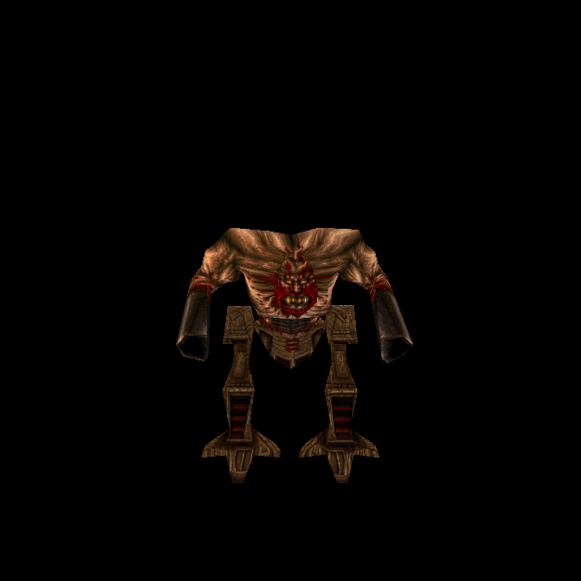

# Armagon: coordinated body and mechanical legs

> Historical implementation record: the initial generated art and lossless-map behavior below are superseded by the [photographic4x WebP92 correction](../tools/texture_sheets/sources/fidelity-2026-10-13/armagon-character.md).

Owner-authorized official-game campaign T-bb7e6282; enemy increment T-b9e82259.
Both models are one enemy and belong in one separate commit/push after Gremlin
`ba2fdf4d`. Classic models, animations and gameplay remain unchanged.

## Source and correspondence

Hipnotic `progs/armabody.mdl`: one216×194 skin,204vertices,398triangles,98poses,
SHA-256 `e827535032c8e83609fedf07c9989c504e7eaa6772ce0d5cf73788e00980f151`.
`progs/armalegs.mdl`: one228×194 skin,134vertices,318triangles,98poses,
SHA-256 `b33a8f7e4cd3fca9b8c9427d8002a5470da44ce919648e1a0045f3f131f73deb`.

ChatGPT imagegen repainted each decoded original native atlas, preserving its
palette, design and layout. The generated body was also a finish-only reference
for the legs. Exact prompts, original model hashes, generated PNGs and recipes
are retained in `tools/texture_sheets/sources/generated-2026-10-12/armabody.*`
and `armalegs.*`. The body retains wounded tan flesh, dark cannons and all four
orange flash islands; the legs retain earthy brown/bronze machinery and red details.

Runtime body1512×1358 and legs1368×1164 (first fits; under the [4x standard](texture-standard-4x-2026-10-12.md) the body is re-fitted at factor 4, 864×776, and the legs are resampled to 912×776) use unchanged native UVs. The first leg
fit correctly failed:6727 actual metal-surface pixels lacked artwork. Independent
bounded registration measured vertical compression in the generated source.
The recorded affine box `[0,4,1368,1210]` resolves coverage with the existing24px
edge limit unchanged. Missing coverage is zero; extension is1123/832841 leg
surface pixels (in the legs' factor-6 fit units, which `SOURCE.json` keeps). Body extension was2585/1202010 at the first, factor-7 fit and is 1241/393303 at the 4x re-fit. No original low-resolution pigment
is copied into either replacement. The fitter records every transform/hash.

## Normal maps and identity boundaries

Both basenames join the existing enemy classification. Catalogue33 registers the
two hash-bound skin-zero diffuse/height variants. Five content-bound normal bakes
cover body native-generated fallback, body authored-native height, body custom,
legs native-generated and legs custom. Normal settings remain strength0.65/cap0.55.

Actual body vertices192–203 form16 muzzle-flash triangles. Their height is255,
with 6 pixels of padding on the native map and 7 on the 4x map (`fit_rogue_skins.flatten_height`: one pixel more on enlarged maps, where the fitter's and the test's rasterizers can differ by a pixel at triangle edges), and their decoded normal is
RGB128,128,255/A255. Padding must not overlap another body surface.255 is required
because the height-shadow receiver treats maximum height as unoccluded;128 could
incorrectly shadow the flash. Authored height also covers the original native body
when replacement skins are disabled. No new luma/emission map is introduced.

Independent review caught filename-only native-height selection. The new optional
`nativeModelSha256` on a stored native-height entry now uses the existing identity
matcher. `gl_mesh` forwards the actual model, and native-only preparation waits for
constrained identities even when custom skins are off. Pending/missing/mismatched
identity retains generated relief from actual native pixels. Reused textures drop
previously approved authored relief; cancelled late callbacks cannot restore it.
Legacy entries without the optional hash retain their established behavior.

## Assembly and trial

Hipnotic's stable assembly uses equal origins and synchronized frame numbers; the
body adds the legs' fixangle to its yaw. The spawn-time64-unit offset is temporary
and must not be baked into the assembly. The finite renderer trial now supports
paired meshes, all98pose pairs, firing frames17/22/35/44/60, standing64,
transition84, death86 and independent ±25-degree body rotation.

Run `python3 tools/serve.py 8000`, then open
`http://127.0.0.1:8000/tests/rogue_skin_gpu_trial.html?model=armagon` and press Run.
Use a fresh browser origin when reviewing changed module dependencies.

Reproduce each fit with `/usr/bin/python3 tools/texture_sheets/fit_generated_skin.py
<recipe.json> --pack resources/hipnotic/pak0.pak`; the default palette archive is
`resources/id1/pak0.pak`. Under the [4x standard](texture-standard-4x-2026-10-12.md) the body
recipe says factor 4, so this reproduces the shipped body. The legs recipe keeps factor 6
(its registration box `[0,4,1368,1210]` is in factor-6 pixels and has no whole-pixel
factor-4 equivalent, so re-fitting would change the accepted registration): fit the legs
with `--output <scratch dir>`, check the diffuse and height against
`standard4x.fitFiles`, then the shipped files come from
`tools/texture_sheets/standardise_4x.py` (record
`tools/texture_sheets/sources/standard-4x/batch3-hipnotic.json`, which refuses to re-run once
it holds results) and `update_enemy_heights.height_for` on the new diffuse. Bake each model through `tools/bake_normals.mjs` using
`--namespace hipnotic --skins --maps '^progs/armabody\.mdl$' --variant armabody/custom`
(or armalegs), with the existing configured Three/canvas dependencies.

## Evidence and limits

Independent public checks17/17pass: native bytes/UVs/all196poses, correspondence,
prior catalogue preservation, exact normal inputs, flash padding and identity
prewarm/revocation/failure paths. Isolated committed-HEAD plus scoped changes passes
67/67 maintained checks, excluding concurrent water/cloak edits. Distribution policy
passes. Composite GPU112/112checks pass,111draws, all98paired poses, four shipped
normal sets settled, zero generated fallbacks or shader/runtime errors. The
single-model Dog regression passes97/97checks across86poses.

The first GPU failure is retained. It used a stale cached gl_mesh dependency that
omitted the newly required model argument; fresh localhost origin with no-store
passes without changing the test gates or adding readiness delays. The first
independent test's warm-normal-cache expectation was corrected; its failure is
also retained. The initial failed leg-coverage measurement is in the recipe.

Independent visual review cleared front/back/oblique, firing, standing and body-yaw
views. Controlled material/pose rendering is verified; boss combat and owner
visual acceptance remain separate. Full evidence is in
`docs/evidence/armagon-skins-2026-10-12`. Root owns any remaining campaign work.
