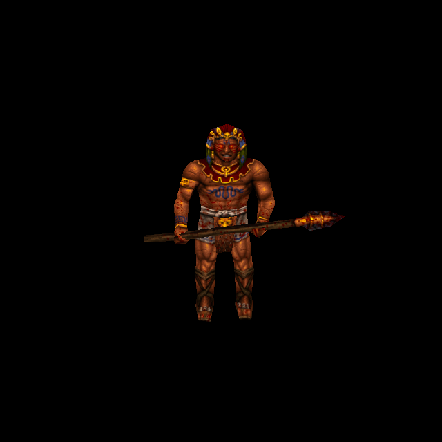
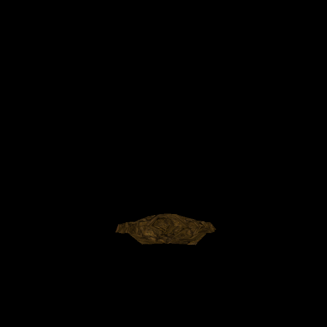

# Aztec Guardian: living, partial stone and stone skins

Official-game campaign T-bb7e6282, increment T-e8decd62. Owner authorizes original-
reference ChatGPT generation and one separate commit/push for each completed enemy.
Predecessor Lava Man `e0febc2f` is published and remote verified.

## Native identity and transformation

Rogue `progs/morph_az.mdl` SHA-256:
`98d86ad428b5ab5643e12921f3f41572eb84c2025a8f05c7b882ccce6bdc4a5f`.
Three ungrouped276×195skins,221vertices,430triangles,142ungroupedposes. Six connected
UV components are two bodies, two staffs and two detached clothing panels. Native
background palette214 is blue RGB47/47/159 and is flood-filled by the model loader;
normal verification uses actual loaded RGBA, not raw palette pixels.

The Egyptian and Greek models have identical headers/UVs/triangles/all pose records,
but different living/partial skins and therefore different model hashes. Their
stone skin2 is identical, SHA-256
`c8cd3d457d9ea848a6c29cb233f2f07e274ca996a75d85ad2baec22cabb4be28`.
That source can be shared in later increments, with separate model gates/directories.

Original QuakeC setup uses frame1/skin2. Wake15 selects frame15/skin1; wake31
selects frame31 and decrements skin1→0. Death begins frame121/skin0, then death9
uses frame129 and increments skin0→1, not2. Spawnflags2/4/8 select Aztec/Egyptian/
Greek respectively; clones inherit their owner's model. These semantics, original
mesh, AI, collision and effects remain unchanged.

## Generation, corrections and fit

ChatGPT imagegen used each original native atlas, with living/material references
to preserve one identity across states. Sources and exact generation/refinement
prompts are retained under `tools/texture_sheets/sources/generated-2026-10-12`:
`morph_az-skin0.png`, `morph_az-skin1.png`, shared `guardian-stone.png`, and the
three `morph_az-skinN.json` recipes. All selected sources are1492×1054. Living
brown skin, red/gold collar/headdress, green feathers, blue markings, pale wrap,
brown boots and weapon designs remain distinct from the stone states.

Review rejected a duplicated ornament on the reverse detached panel; a targeted
image edit removed it. Review also rejected overly vivid partial-state colour and
square mosaic grain in full stone. New original-reference generation produced
continuous mineral detail and a muted brown transition. Its partial-state image
then failed coverage:1053real back-head/arm/knee UV pixels contained blue backdrop.
Independent diagnosis proved none were native background; no threshold/bleed
relaxation or blue-pixel exception was accepted. A material-only edit of the
previously fitted layout resolved the geometry while retaining the muted material.
Initial, provisional and misaligned source PNGs and exact prompts are retained.

Final fits use the existing blue-grey matte and24pixel edge reach, unchanged native
UVs and no native pigment copying. Outputs1656×1170 each cover858760surface pixels:
3665living,2079partial and2206stone pixels need edge extension; zero uncovered.
Unlike Eel charge skins, these states change physical materials, so each has its
own anatomical height. Shared stone reuse is conditional on exact source/layout
proof. No arbitrary emission or flat-height bypass is introduced.

Catalogue38 registers three explicit indices and unique directories
`morph_az/custom`, `custom1`, `custom2`, all constrained to the exact native model.
Six prepared normal inputs cover three loader-decoded native states and three
custom states. Provisional bakes were archived outside runtime; only final
content-bound inputs are in the manifest and runtime registry.

## Try and evidence

Run `python3 tools/serve.py 8000`, open
`http://127.0.0.1:8000/tests/rogue_skin_gpu_trial.html?model=morph_az` and press Run.
All426skin/pose combinations render, plus exact ordered wake/death samples and
native/custom/detail/Classic controls. No game/save is automatically started.

Reproduce each recipe with `/usr/bin/python3 tools/texture_sheets/fit_generated_skin.py
<recipe> --pack resources/rogue/pak0.pak`. Existing baker options:
`--namespace rogue --skins --maps '^progs/morph_az\.mdl$' --variant morph_az/customN`
(use `custom` for0), with configured Three/canvas dependencies.

Independent10/10checks pass: native states/UVs/142poses/blue floodfill, all-culture
geometry/shared stone equality, exact cross-culture rejection, unique state slots,
source/output/prior catalogue, six exact normal inputs and actual QuakeC transitions.
GPU446/446checks pass over451draws, six shipped normal sets settled, no generated
fallback or shader/runtime errors.38views: base angles0–3, poses4–18, partial19–22,
stone23–26, ordered transitions27–31, final controls32–37(native34/fitted35).
Isolated committed-HEAD plus scoped source passes112/112checks; distribution passes.
Independent final visual review is retained beside these receipts.

This verifies controlled asset/material/state behavior. Full level combat and
owner aesthetic acceptance remain separate. Concurrent water/cloak work is excluded.

Under the [4x standard](texture-standard-4x-2026-10-12.md), the three Aztec Guardian
skins are re-fitted at factor 4 through their recipes: 1104×780. Sizes and pixel counts
above describe the first fit.
