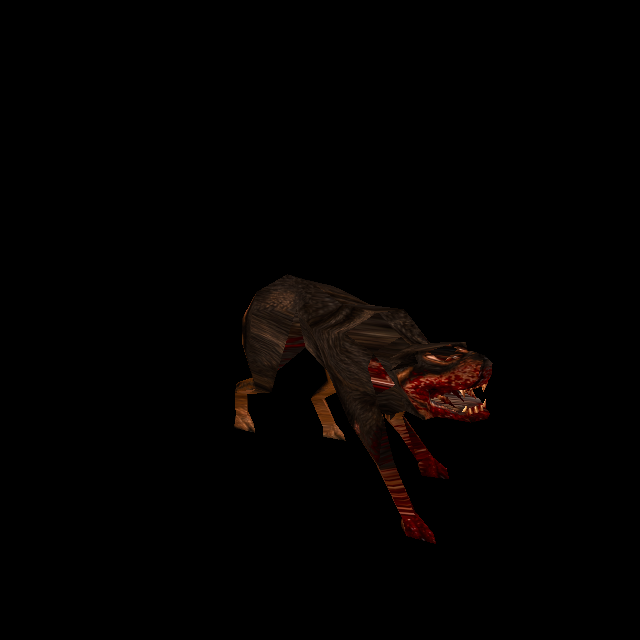

# Dog: original-design generated high-resolution skin

Campaign T-bb7e6282, Dog card T-cd37aeb2. The owner authorized ChatGPT image
generation from original files and a separate commit/push per completed enemy.
This increment adds the missing body skin; the existing HD `h_dog` head is unchanged.

## Source and fit

The reference was decoded directly from the original `progs/dog.mdl` skin0 using
the native palette, nearest-enlarged4× solely for imagegen. Model SHA-256:
`c84104192b336b5360033a4efcc7e033fce4589d1af6c3c895101a9c6d6932b6`.
It has one 312×169 skin,236 vertices,426 triangles and 86 poses. Both official mission
packs inherit the same identity.

The **ChatGPT built-in imagegen tool** produced the 1704×923 atlas retained at
`tools/texture_sheets/sources/generated-2026-10-12/dog.png`. Its neighbouring
`dog.json` contains the exact prompt, generated-source hash and fitting recipe.
The prompt locks layout, dark brown coat, tan markings, blood-red injuries,
original design and all small mouth pieces. No original pixels were painted into
the final replacement; the original model/skin stays available for Classic.

The supplied/generated atlas has exactly the native aspect ratio. Independent
planning checked native landmarks and fine-detail correlation 0.584 over the UV
surface. `fit_generated_skin.py` calls the existing native-atlas importer with a
reviewed slate-blue matte policy. Per-component colour ownership and edge bleed
reuse the established implementation. Only 111 of 347645 surface pixels (0.032%) at the 4x fit (189 of 779314, 0.024%, at the first 6x fit)
need supplied edge-colour extension. No geometry, UV, animation or gameplay change.

[Runtime 1248×676 PNG](../newer/enemies/dog/custom/diffuse.png) (re-fitted at factor 4 for the
[4x standard](texture-standard-4x-2026-10-12.md); first published at 1872×1014), matching
`height.webp`, and `SOURCE.json` are under `newer/enemies/dog/custom`.
The existing height author generates relief from the final image; the existing
normal baker ships its exact decoded-input normal/scalar payload. The native
stored height/bakes remain available. Catalogue version30 adds one exact-model,
skin-zero Dog variant; other catalogue entries and head bytes are preserved.

## Try and verify

Serve with `python3 tools/serve.py 8000`, open
`http://127.0.0.1:8000/tests/rogue_skin_gpu_trial.html?model=dog`, and run the checks.
The existing finite model trial now accepts Dog with its actual id1 pack and
Fish as a wrong-model control. Normal Newer Game loads the same replacement.

Independent tests **6/6** pass: all native UV/triangles/86 poses, actual runtime
image decoding, generated-source signature/dimensions/hash, unchanged head and
catalogue entries, model/skin/Classic/failure boundaries, and exact normal inputs,
scalar equality and public shipped-cache preparation without regeneration.
The initial copied catalogue-fixture exclusion and source-only canvas-decoder
failure are retained in the test log; both were corrected without product changes.
The generated source decodes in Pillow; actual runtime diffuse/height decode in
the production test canvas and browser.

GPU **97/97** checks pass across 86 poses, original/custom and detail toggles,
Classic pixel equality, shipped normal readiness and clean shader/runtime checks.
Existing Rogue/skin/startup regressions **27/27** and distribution policy pass.

Independent review initially flagged stretched fur across shoulder/spine and
narrow limb faces. [Native control](evidence/dog-skin-2026-10-12/view-13.png) and
[same-pose replacement](evidence/dog-skin-2026-10-12/view-14.png) show stretching on
the same faces, also with relief disabled. The native mesh has 11 zero-area UV
triangles and 22 with area at most 1 native texel. Detailed fur makes this inherited
limitation more apparent; no new misregistration or geometry correction is
indicated. Final independent verdict: no blocking defect; ready for authorized
commit/push. All source/output/normal hashes were checked.

Reproduce the fit with `/usr/bin/python3 tools/texture_sheets/fit_generated_skin.py
tools/texture_sheets/sources/generated-2026-10-12/dog.json --pack resources/id1/pak0.pak`.
Rebake using the existing baker with `--namespace id1 --skins --maps
'^progs/dog\.mdl$' --variant dog/custom` and the configured Three/canvas paths.

Evidence is in `docs/evidence/dog-skin-2026-10-12`. This is exact-model rendering
and interface qualification, not full campaign/combat acceptance or release.

Final isolated-code check: **38/38**, against committed HEAD plus only this Dog increment, with runtime assets mounted read-only for the test. Concurrent cloak/water source changes were excluded.
