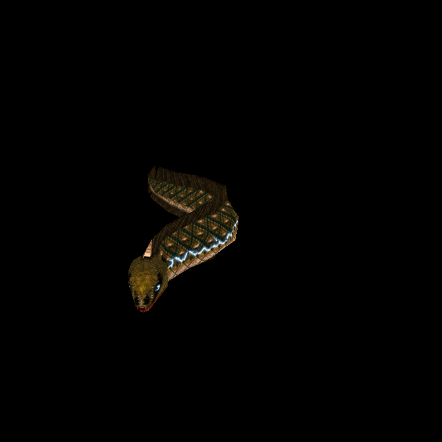

# Electric Eel: one body, six charge skins

Official-game campaign T-bb7e6282; increment T-89884f7b. Owner authorizes original-
reference ChatGPT generation, preserving design, and a separate commit/push for
this completed enemy. Predecessor Armagon is published as `eaca8f0c`.

## Original model and state behavior

Rogue `progs/eel2.mdl` SHA-256:
`58b9c4a4af9953f8c024158ba8a7cebd33e19834440c09026fd5931cb6b831a7`.
Six separate136×194skins,148vertices,260triangles,21poses. The18UV components are
two long body strips and sixteen detached triangular mouth/flesh pieces. Native
charge skins change296,416,838,1169,1473pixels respectively; the triangles are
identical across all six skins. These are entity skin indices, not grouped skin
animation slots. The unrelated eelgib death model remains native.

Original QuakeC selects skins1–4 on attack poses1–4 and changes the existing
DIMLIGHT/BRIGHTLIGHT flags. Attack12 sets pose5/skin5 then calls eel_melee, which
unconditionally resets skin/effects to zero in that same invocation. Skin5 remains
available without extending its lifetime. Pain/death reset behavior is preserved.
Independent tests inspect actual owned progs.dat control flow; no gameplay edits.

## Generated artwork and fitting

ChatGPT imagegen received the decoded native skin0 as the base reference. Each
of five further calls used the detailed base as edit target and its own original
native charge skin as positional/colour reference. All six source PNGs, exact
prompts and recipes are retained at
`tools/texture_sheets/sources/generated-2026-10-12/eel2-skin0..5.*`.
Original olive/brown scale lattice, pale underside, small eyes and restrained red
mouth pieces remain; the two columns of triangles remain separate, including
the dark maroon reverse pieces.

The existing full-atlas fitter output 1088×1552 at the first, factor-8 fit (544×776 at factor 4 under the 4x standard) without moving native UVs. Base
coverage:842388surface pixels,15358edge extensions, zero missing coverage. State
artwork is fitted with the same bounded24pxedge policy. The state compositor uses
only a one-native-pixel square dilation of the original state's difference mask,
then an inward one-output-pixel feather. Inside this envelope pigment comes from
the corresponding ChatGPT state; outside it pixels come from the approved HD
base, exactly. No original low-resolution pigment is used. Original palette
indices provide correspondence only. All sixteen detached pieces remain byte-
identical, preventing animation from changing unrelated skin detail.

Before reuse, the fitter verifies the base model/source claims and both actual
base output hashes against SOURCE.json.files. A donor mutation is rejected;
negative checks for altered diffuse and height are retained.

## Height, normal and engine integration

Catalogue34 adds six explicit skin bindings and six unique directories:
`eel2/custom`, `custom1` through `custom5`. Unique directories matter because the
existing material cache keys by directory. All variants are gated by the exact
native model hash. Existing geometry, normal convention and Classic remain intact.

Every custom state shares the same anatomical height derived from the HD base;
electricity changes pigment, not surface grooves. Native states share authored
native skin0 height, with exact model-identity gating introduced by the Armagon
increment. Eighteen baked inputs cover six native-generated fallbacks, six
native-authored and six custom diffuse/height pairs. No new emission/luma or
lighting behavior is added; existing QuakeC dynamic light remains responsible.

## Try, reproduce and evidence

Run `python3 tools/serve.py 8000`; open
`http://127.0.0.1:8000/tests/rogue_skin_gpu_trial.html?model=eel2` and press Run.
It renders every one of21poses for all6skins and compares native/custom/Classic
for each charge state. This is a bounded production alias/material trial, not
an automatically started game or changed save.

Fit skin0 first, then1–5 using `/usr/bin/python3 tools/texture_sheets/fit_generated_skin.py
<recipe.json> --pack resources/rogue/pak0.pak`. Each state verifies its approved
base before reuse. Bake through `tools/bake_normals.mjs` with `--namespace rogue
--skins --maps '^progs/eel2\.mdl$' --variant eel2/customN` for each directory
(`custom` for0), with configured Three/canvas module dependencies.

Independent public tests15/15pass, including exact owned bytes, all UVs/poses,
six material identities, immutable noncharge anatomy, eighteen decoded normal
inputs and original QuakeC reset semantics. An initial test counted unused model
texture-array slots; corrected to the six actual skins, with failure retained.
GPU147/147checks pass over161draws; twelve active native/custom normal sets are
shipped and settled, with no generated fallback or runtime/shader error. All
51saved views are retained: base angles0–3, base poses4–24; charge states begin
25,29,33,37,41, each front/back/native/fitted; final controls45–50.

Isolated committed-HEAD plus scoped changes:82/82checks pass, excluding concurrent
water/cloak work. Distribution policy and both donor-integrity checks pass.
Evidence is under `docs/evidence/eel-skins-2026-10-12`. Independent visual review
and its limits are recorded there; controlled rendering does not claim live
combat testing, owner aesthetic acceptance or a wider release.

Under the [4x standard](texture-standard-4x-2026-10-12.md), the base and the five charge
skins are re-fitted at factor 4 through their recipes (base first, so the charge skins
still differ from it only inside the electrical masks): 544×776. Sizes and pixel counts
above describe the first fit.
