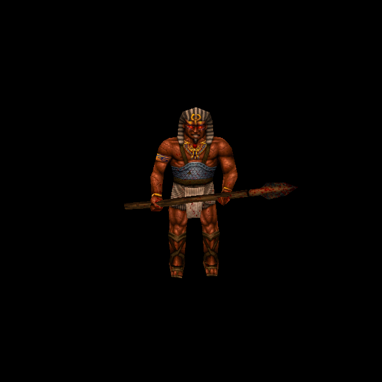

# Egyptian Guardian: original-design living and stone states

Official-game campaign T-bb7e6282, increment T-5f22456c. Owner authorizes original-
reference ChatGPT generation and a separate per-enemy commit/push. Aztec Guardian
`6f308cfb` is the published predecessor; all its assets remain byte-identical.

Rogue `progs/morph_eg.mdl` SHA-256:
`14468fccffaa1508c03610dd58fb51cd9058ca3bab036bca18f7a41cb37c195b`.
Three276×195skins,221vertices,430triangles,142ungroupedposes and six UV components.
Its shared geometry/stone proof and native state sequence are described in
[Aztec Guardian](aztec-guardian-skins-2026-10-12.md). Egyptian living and partial
skins remain separate; exact model hashes prevent cross-culture skin selection.

ChatGPT imagegen repainted original Egyptian skin0, preserving the grey/tan striped
headdress, neck decoration, grey-blue chest band, pale wrapped cloth, dark skin,
boots, wooden staff and plain detached panels. The fitted living source then
served as the strict geometry target for a material-only partial-stone edit, with
original skin1 guiding the muted brown/olive transition and the verified common
stone source guiding mineral detail. Both1492×1054sources and exact prompts are
retained in `tools/texture_sheets/sources/generated-2026-10-12/morph_eg-skin0.png`,
`morph_eg-skin1.png` and their recipes.

Skin2 reuses `guardian-stone.png`: actual native stone pixels, headers, UVs,
triangles and every pose are identical across the three cultures. The Egyptian
recipe records this reuse proof and its own whole-model identity. Each model/skin
still has a unique runtime directory. There is no new generation of an already
identical approved stone asset and no sharing of culture-specific living art.

All three fits1656×1170cover858760surface pixels with zero missing coverage;
edge extension is1243/947/2206pixels for living/partial/stone respectively. The
existing blue-grey matte,24pixel reach, UV positions and height settings remain
unchanged. No exceptions, original pigment copying, new luma or geometry edits.
Each material state has its own height; common stone diffuse/height are exactly
the same as the published Aztec stone state.

Catalogue39 registers Egyptian indices0–2 under `morph_eg/custom`, `custom1`,
`custom2`, constrained to the exact model SHA. Six native/custom normal inputs
are verified: two common stone inputs reuse published content keys, four inputs
are newly baked. Native verification uses loader-flood-filled blue-background
RGBA, not raw palette PNGs. Classic, failure and wrong-identity paths are preserved.

## Try and verification

Run `python3 tools/serve.py 8000`; open
`http://127.0.0.1:8000/tests/rogue_skin_gpu_trial.html?model=morph_eg` and press Run.
The finite trial renders all426skin/pose combinations plus exact frame1/skin2,
frame15/skin1, frame31/skin0, frame121/skin0 and frame129/skin1 transitions.
Contracted awakening poses are native geometry, not an atlas error.

Reproduce with `tools/texture_sheets/fit_generated_skin.py` and each Egyptian
recipe against owned Rogue pak0. Bake via `tools/bake_normals.mjs --namespace rogue
--skins --maps '^progs/morph_eg\.mdl$' --variant morph_eg/customN` (`custom` for0),
with the established Three/canvas configuration. Shared source reuse is verified
again by independent native and decoded-payload checks.

Independent Guardian20/20checks pass (Aztec plus Egyptian), including original
geometry/states, actual QuakeC timing, exact cross-culture rejection, blue
floodfill, source/output identity, published Aztec preservation and six Egyptian
normal inputs with two shared/four new keys. GPU446/446checks pass over451draws;
six normal sets shipped/settled, no generated fallback or shader/runtime error.
38views retained with the same indices as Aztec: angles0–3, poses4–18,
partial19–22, stone23–26, transitions27–31, controls32–37(native34/fitted35).

Isolated committed-HEAD plus scoped source passes122/122checks; distribution passes.
Independent source/render review is retained with all receipts under
`docs/evidence/morph_eg-skins-2026-10-12`. This qualifies controlled material/state
rendering, not live level combat or owner aesthetic acceptance. Concurrent
water/cloak changes remain excluded.
