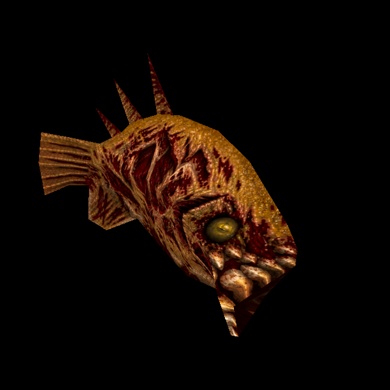

# Rotfish: original-design generated HD skin

Official-game campaign T-bb7e6282, Rotfish card T-74803f43. The owner authorized
ChatGPT generation from the original atlas and a separate commit/push per enemy.

The reference is the actual `progs/fish.mdl` skin zero from Quake, decoded with its
native palette and nearest-enlarged 4× for imagegen. Model SHA-256:
`e6a0396ac97d981cd49b39f7af8f1f32d9f910768f7a554f59bcb5926c2a3568`.
There is one 260×194 skin, 97 vertices, 172 triangles and 66 poses. The official
mission packs inherit this model; other model bytes cannot select this variant.

ChatGPT's built-in imagegen produced the 1452×1083 source retained at
`tools/texture_sheets/sources/generated-2026-10-12/fish.png`. The adjacent recipe
`fish.json` records the exact generation prompt, input identity, generated hash,
dimensions, matte policy and fit parameters. The original ochre/tan scales and
bone, dark red exposed flesh, ivory teeth, dull yellow-green eyes and all fin/tail
islands remain in their native arrangement. Independent source comparison found
only 0.0384% aspect difference and fine-detail correlation 0.5314 over actual UVs.

The existing complete-atlas fitter writes the [runtime PNG](../newer/enemies/fish/custom/diffuse.png) (1560×1164 at the first, factor-6 fit; 1040×776 under the [4x standard](texture-standard-4x-2026-10-12.md)),
matching height and `SOURCE.json`. Its explicit dark-brown mask preserves enclosed
dark flesh; per-native-component colour ownership and bounded edge extension
prevent neighbouring islands supplying seam colours. Only 6,545 of 974,703 surface
pixels (0.67%) need source-colour extension; no native skin pigment is copied.
The original model, UVs, pose data, AI, collision and native skin remain unchanged.

Catalogue version 31 adds the exact-model, skin-zero `fish/custom` entry. Matching
height and normal data use the existing authoring and normal-bake pipeline. One
new custom normal payload is added to the distribution closure; the existing
native generated bake remains intact. Prior catalogue entries, including Dog,
are preserved. Historical preservation tests now explicitly select their fixed
baseline keys: deletions/mutations still fail exact hashes while independently
tested later additions need no recurring exclusion lists.

## Try and reproduce

Serve with `python3 tools/serve.py 8000` and open
`http://127.0.0.1:8000/tests/rogue_skin_gpu_trial.html?model=fish`. Run the finite
model checks. The existing trial reads actual owned PAK members, renders all poses
and saves source/normal/Classic comparisons; it does not alter saved games or run
an ongoing game loop. Normal Newer Game uses the same catalogue replacement.



```sh
/usr/bin/python3 tools/texture_sheets/fit_generated_skin.py \
  tools/texture_sheets/sources/generated-2026-10-12/fish.json \
  --pack resources/id1/pak0.pak
```

The existing baker, with configured Three/canvas modules, uses
`--pack resources/id1/pak0.pak --namespace id1 --skins --maps '^progs/fish\.mdl$'
--variant fish/custom`.

## Checks and limits

Independent public tests **6/6** pass: actual model/UV/triangle/all-pose bytes,
source and output identity/dimensions, every prior catalogue entry, selection,
Classic/off/pending/failure/shutdown behavior, exact decoded normal input/witness,
scalar equality and public preparation selecting shipped data without regeneration.
Existing Rogue/skin/startup regressions **27/27** and distribution policy pass.
GPU **77/77** checks cover all 66 poses, four viewing angles, original/custom,
normal/detail and Classic controls with no shader/runtime errors or pending assets.

Independent source and rendered review found no blocker. Eyes, teeth, ribs, fins
and tail align coherently. Native-versus-replacement controls confirm the angular
mouth and stretched narrow faces are inherited model/UV limitations. Underwater
gameplay, every lighting condition, owner appearance acceptance and release remain
separate from this controlled renderer qualification. Evidence and final source
hashes are retained under `docs/evidence/fish-skin-2026-10-12`.

Final isolated-code verification: **44/44** checks against committed HEAD plus only this Rotfish increment; concurrent water/cloak source changes excluded.
