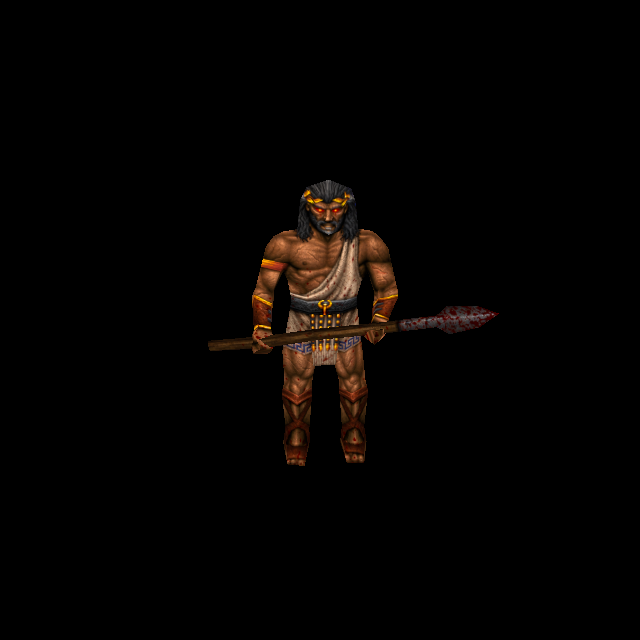

# Greek Guardian: original-design living and stone states

Official-game campaign T-bb7e6282, increment T-13eafa13. Owner authorizes original-
reference ChatGPT generation and separate per-enemy commit/push. Egyptian Guardian
`a155bd16` is the published predecessor; both earlier culture families are preserved.

Rogue `progs/morph_gr.mdl` SHA-256:
`662aa03785b4a6d2689670bebc5a9d081c36541347e324fac3957f599eab3be8`.
Three276×195skins,221vertices,430triangles,142poses and six UV components. Shared
geometry/stone identity and exact awakening/death contracts follow the independently
verified [Guardian relationship](aztec-guardian-skins-2026-10-12.md). Greek living
and partial states retain their own artwork and exact whole-model binding.

ChatGPT imagegen repainted original skin0, preserving long charcoal hair/beard,
gold temple accents, tan/brown skin, diagonal pale toga with blue-key hem, dark
belt, reddish-brown guards, boots, wooden/stone staff and distinct detached panels.
The front panel keeps its strip/fringe design while the rear remains plain cloth.
A material-only edit of this successfully fitted layout produces partial stone,
using original skin1 for its muted brown appearance and the verified commonstone
source for natural mineral detail. No geometry changes were accepted.

The two1491×1055sources and exact prompts/recipes are retained under
`tools/texture_sheets/sources/generated-2026-10-12/morph_gr-skin0.*` and `skin1.*`.
Skin2 uses the existing1492×1054 `guardian-stone.png`; its recipe records identical
native stone pixels, headers, UVs, triangles and pose bytes, plus the distinct
Greek whole-model hash. Source sizes are individually pinned rather than assumed.

Final outputs1656×1170cover858760surface pixels each with zero missing coverage.
Edge extensions are1650/2103/2206pixels for living/partial/stone. Existing matte,
24pixel reach, UVs and material-specific height generation are unchanged; no
background exception, native pigment copying, new luma or height bypass is added.
Catalogue40 adds three unique Greek directories `morph_gr/custom`, `custom1`,
`custom2` and explicit skin indices. Six native/custom normal inputs are verified;
two commonstone inputs are reused and four new payloads are baked. Published
Aztec/Egyptian images remain byte-identical.

## Try and verification

Run `python3 tools/serve.py 8000`; open
`http://127.0.0.1:8000/tests/rogue_skin_gpu_trial.html?model=morph_gr` and press Run.
All426skin/pose combinations plus exact native transitions are rendered: setup
frame1/skin2, wake15/skin1, wake31/skin0, death121/skin0 and death129/skin1.

Reproduce each recipe through `tools/texture_sheets/fit_generated_skin.py` against
owned Rogue pak0. Bake with `tools/bake_normals.mjs --namespace rogue --skins
--maps '^progs/morph_gr\.mdl$' --variant morph_gr/customN` (`custom` for0), using
configured Three/canvas dependencies. Native inputs include actual loader blue-
background floodfill; commonstone content identity is checked again.

Independent30/30checks pass across all three cultures: nine distinct runtime
bindings including simultaneous cache isolation, native geometry/states/blue
floodfill, exact cross-culture rejection, source/output identity, previousculture
preservation, eighteen normal references and original QuakeC state semantics.
GPU446/446checks pass over451draws; six normal sets shipped/settled with no generated
fallback or shader/runtime error.38views: angles0–3, poses4–18, partial19–22,
stone23–26, transitions27–31, controls32–37(native34/fitted35).

Isolated committed-HEAD plus scoped source passes132/132checks and distribution
policy passes. Independent source/render review cleared. Evidence is retained
under `docs/evidence/morph_gr-skins-2026-10-12`. This verifies controlled material/
state rendering; live level combat and owner appearance acceptance remain separate.
Concurrent water/cloak changes are excluded.
