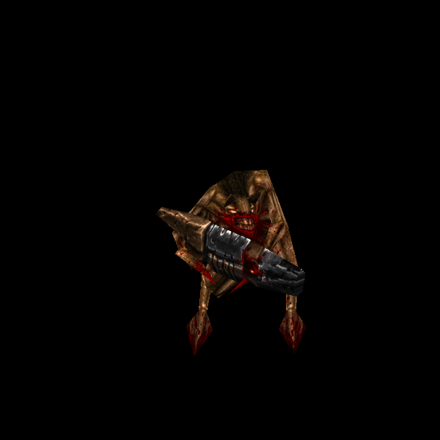

# Gremlin: generated body and weapon skin

Official-game campaign T-bb7e6282, Gremlin card T-3f8f9b0a. This is the next
owner-authorized per-enemy generation and commit/push after Rotfish `aa33d6d4`.

## Native identity and source

Hipnotic's `progs/grem.mdl` has one 308×169 skin, 123 vertices, 245 triangles and
179 poses. SHA-256:
`bdc4443c3a0d0bb30b4302bb7b1d9759344690c6148bea08a747436191325763`.
The actual QuakeC uses it for both `monster_gremlin` and `Gremlin_Split`.
Weapon theft changes behavior and poses, not the skin field.

There are eight authored pieces: front/back body, two small triangular pieces per
half, and a weapon below each body. The weapon is required: its geometry expands
from roughly eight units standing to 44 units in `gfire1.ASC`, frame 135. The
separate `h_grem` head remains native and is not given the body atlas.

ChatGPT's built-in imagegen used the complete original atlas, decoded with the
native palette and nearest-enlarged 4× as the reference. The 1692×930 generated
image and exact prompt/recipe are retained in
`tools/texture_sheets/sources/generated-2026-10-12/grem.png` and `grem.json`.
The prompt preserves grey-brown hide, the dark dorsal stripe, bloody chest/claws,
the tiny face's atlas location and every weapon piece. Original files are unchanged.

## Fit and renderer integration

The existing complete-atlas fitter produces the [1848×1014 runtime PNG](../newer/enemies/grem/custom/diffuse.png),
matching height and `SOURCE.json`. Source aspect differs by only 0.172%; original
UV positions remain the correspondence. The black matte, native-component colour
ownership and bounded edge extension use the existing pipeline. Extension affects
28,351 of 924,429 surface pixels (3.07%); no native pigment is copied. Ten rasterized
UV components correspond to the eight authored pieces, not ten invented parts.

Fine-detail correlation with native pixels is relatively low (0.181) because of
redrawn folds/highlights. This was not treated as fit proof: independent review
required actual face and firing-weapon renders before clearance.

Catalogue version 32 adds one exact-model skin-zero variant. `grem` joins the
existing enemy classification so its native and replacement materials receive the
existing normal pipeline. Matching height is authored from final diffuse pixels;
the normal baker adds one native and one custom payload with exact input identities.
No model, UV, animation, theft behavior, AI or collision changes. Classic, disabled
replacements, wrong model bytes and failed downloads keep their established paths.

## Try and reproduce

Serve with `python3 tools/serve.py 8000` and open
`http://127.0.0.1:8000/tests/rogue_skin_gpu_trial.html?model=grem`. The finite trial
renders every pose and explicitly saves frame 135 in addition to sampled poses.
It uses the actual owned Hipnotic model and production alias/material renderer.



```sh
/usr/bin/python3 tools/texture_sheets/fit_generated_skin.py \
  tools/texture_sheets/sources/generated-2026-10-12/grem.json \
  --pack resources/hipnotic/pak0.pak
```

The existing normal baker uses `--pack resources/hipnotic/pak0.pak --namespace
hipnotic --skins --maps '^progs/grem\.mdl$' --variant grem/custom` with configured
Three/canvas module paths.

## Verification and limits

Independent public tests **6/6** pass, covering every native UV/triangle/pose,
actual frame 135 and weapon expansion, source/output identity, unchanged prior
catalogue, native detached head, exact model selection, Classic/off/pending/failure
boundaries, and exact decoded normal input/witness plus shipped preparation.
Existing Dog/Fish/skin/startup regressions **26/26** and distribution policy pass.
GPU **190/190** checks cover all 179 poses, actual normal readiness and
original/custom/detail/Classic comparisons with no shader/runtime failures.

Independent review found no blocking defect: the rendered face, claws, dorsal
stripe and metal/brown weapon regions align coherently. Native/replacement controls
preserve the same silhouette and facial location. Source/output and both normal
payload hashes were checked. Visual inspection covers saved angles and firing
pose, not every pose by eye. Actual weapon theft/combat and owner aesthetic
acceptance remain separate from these controlled renderer/interface checks.
All evidence is retained under `docs/evidence/grem-skin-2026-10-12`.

Final isolated-code verification: **50/50** checks against committed HEAD plus only this Gremlin increment; concurrent water/cloak edits excluded.
