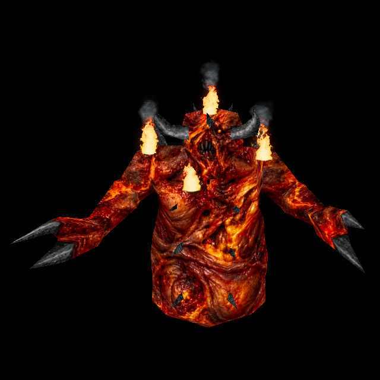

# Lava Man: living furnace

Implemented on T-17dbe483; publication and owner acceptance are recorded separately. The owner rejected the repetitive molten pattern
and requested a photorealistic, unsettling eldritch creature. The selected image
uses asymmetric heat-damaged flesh, a distorted facial focal point and irregular
molten wounds, retaining Lava Man's red/orange/yellow body and charcoal appendages.
The owner then required pixel-shader fire and smoke emerging from the model, with
continuous stretching and distortion of both the face and whole body.

## Selected artwork

The registered source is
`tools/texture_sheets/sources/fidelity-2026-10-13/lavaman-eldritch-registered.png`,
SHA-256 `1ea682fc68686340405b6b12bfd30f318c9348fb8a1f7db35b46faf9f3ff1ffc`.
Its sibling `lavaman-eldritch.json` retains both ChatGPT image generation prompts,
source identities and references. The owner's enhanced Shambler and approved
Armagon supply the material/character direction; the original Lava Man supplies
the exact UV layout and palette family. The first eldritch generation missed a
small UV component and was rejected by the fitter. A second image edit restored
the proven layout; no coverage tolerance or model geometry was relaxed.

The selected source fits all 48 UV components at 1200×776 (4× native). All 492698
surface pixels are covered, including 5686 pixels of bounded edge extension.
Diffuse and height are WebP quality92. The custom normal sample is
`e18ec42cd910007f2392e1e92dbdd85bd8aac5bcf503b1c34d3c3bb14e3ac465` and is derived
from the actual decoded shipped inputs. The earlier patterned candidate is not
selected; its source/normal and review pictures remain in local rejected-candidate
custody. Native PAK images/models remain local and are not redistributed.

## Runtime design and preserved contracts

Independent plan receipt `attachment:141a0901-f95a-4a0b-8c90-55a27c2c4406`
selects per-entity visual position/normal buffers, composed after native animation
interpolation. The engine's canonical pose, blend and interrupted-blend lead arrays
never contain cosmetic deformation. Each draw starts from the canonical
attributes, so pause, rewinds and repeated draws cannot accumulate distortion.
A smooth spatial field provides whole-body strain and a stronger head-local term;
coincident seam vertices receive identical displacement. Normals follow the inverse
transpose of that field's Jacobian. Gameplay origin, collision, native poses,
attack timing and model bounds remain unchanged.

The shader effects reuse the existing torch flame and fireball smoke material,
texture and instanced-layer primitives. They own their own bounded buffers and
clock inputs; they do not consume the wall-torch or projectile emitter pools.
Eight native UV anchors sample the already-deformed triangles barycentrically.
This keeps emission attached to the actual surface rather than approximating it
by deforming a pre-interpolated anchor. The limits are eight live Lava Man
entries, eight flame cards and at most24 smoke puffs per entry. Overflow retains
the canonical model. Main actors take priority over cached portal figures; inactive,
distant and disabled portal figures release their slots. Figure construction does
not allocate the effect until that view is active. Shared noise/atlas textures are borrowed, never disposed.
If either shared image is unavailable, the deforming body remains usable and the
shader layers are removed. Shared fireball asset readiness reports that condition;
Lava Man status reports its bounded entries/errors/overflow, not texture readiness.

Admission requires the exact native `progs/lavaman.mdl` identity
`b81bb7f5cebb2889cfd2f431f743200f672d0195b05fe3faa98b50163fed7fb1`, native skin0,
Newer enemies enabled and the selected ready custom material. Chthon shares UV
layout but is a different identity and remains unaffected. Classic temporary
passes bind canonical attributes without overwriting the retained visual buffers;
actual disable, fallback, entity reuse, scene changes and map clear restore or
release owned state. Point/sun shadow capture reads the deformed geometry; the
existing floor-shadow projection uses the same visual positions, retaining
its refresh interval. No shadow shader duplication is needed.

## Try the moving creature

Serve the checkout with `python3 tools/serve.py 8000`. With the owned official
packs configured, open `/tests/rogue_skin_gpu_trial.html?model=lavaman&externalGames=1&lavaEffects=1`.
Choose **Preview 6 seconds** to watch the actual model with the native walk1 pose
held fixed. Pause/Resume and Stop control that bounded preview; nothing starts
automatically. **Run Rogue enemy checks** produces the full static and timed
verification. Preview frames do not collect screenshots or grow a receipt array.
The normal game and active level-window figures use the same production hooks.

## Verification and fixes

Test-first commit `7f3d22337aa1a3932fe27af00b1d379970f4d6ec` contains only the
timed GPU tests and bounded preview, on integration base
`5384d6d9bcb358367e6c856e1f84c9b6f0b23d4e`. Frozen source plus the byte-identical
committed fixtures reproduced145 checks:122pass and23 expected missing-behavior
failures,130 draws and no GL errors. All fixed-pose face/body motion and emitted
fire/smoke coverage were zero. Verified RED receipt:
`attachment:a592c63f-b148-45f1-bba8-88ce3349113e`. The first checkpoint hook attempt
failed because the invocation omitted Cargo from PATH; the corrected invocation
passed the full normal hook, including41 engine checks and universal Mac build.
The failed attempt remains preserved; no hook was bypassed.

The implemented timed trial passes147 checks, including the same positive
movement/effect checks and two additional real distance-fog checks. Four fixed-pose
times1.125/1.487/2.031/2.773s produce visible independent flame/smoke pixels beyond
the body and changed face/body positions, silhouettes and packed depth. The fog
variant compiles the USE_FOG shader branch and measures reduced emitted-light
contrast at the effect's own depth. Native geometry, selected material,90 poses,
normal readiness and Classic controls are also verified.

The covering run passes133 checks across14 modules. It includes twelve independent
Lava CPU cases,270 native pose/time samples, analytic-normal agreement with
independent finite-difference tangents, seam coincidence, preserved triangle
orientation, pause/rewind, interrupted-blend input preservation, actual Classic
save/restore, actual Chthon substitution, bounded allocations and scene cleanup.
Seven additional independent audit checks cover all eight barycentrically attached emitters,
borrowed asset loss/recovery, attribute ownership and main/portal pool priority.

Findings fixed before publication:

- Classic draws of another native pose initially retired the Newer buffers and
  rebound the wrong pose. Classic is now handled before topology invalidation;
  the real save/restore regression passes without a subsequent draw repairing it.
- Model reuse could restore old Lava positions into a replacement mesh. Cleanup
  targets its original geometry and restores only attributes it still owns.
- Cached portal figures could occupy all eight slots indefinitely. Inactive
  figures release state, and visible main actors can replace ghost allocations.
- A pre-existing desktop loading-screen import bypassed the required engine hook
  boundary. It now reuses that same function through hooks/install; the dedicated
  hook/loading tests pass, with no progress-bar behavior change.
- The height-shadow fixture assumed a shareware-only catalogue and fixed old
  counts. It now resolves actual identities across all three official PAKs and
  verifies148 native and54 custom bindings, retaining its independent nine-tap
  filter oracle, Armagon span handling and unchanged-diffuse assertions.

The independent CPU performance trial uses eight actors with859 expanded vertices
apiece,120 warm-up frames and240 measured frames. Its final measured block took
2.094ms median and2.368ms p95 for all eight actors' public draw+effects update.
All56 owned typed arrays and16 effect meshes/materials were reused; typed storage
was176192bytes. These are local Node CPU observations, not GPU frame-time promises.

Final normal-hook, exact-candidate review and Dev publication receipts belong to
the Bluey card. Controlled rendering is verified separately from live combat,
headset behavior and the owner's aesthetic acceptance. The shared main checkout
and its preserved unfinished work are not replaced by this delivery.
