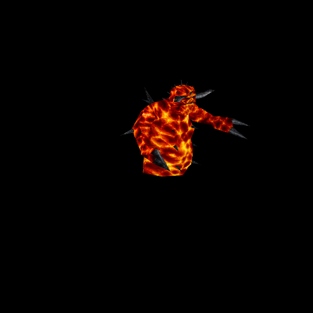

# Lava Man: original molten skin and dark appendages

> Artwork correction in progress: the owner rejected this first design. See
> [the eldritch Lava Man record](lavaman-eldritch-2026-10-13.md) for the selected
> replacement source and the separately requested runtime fire/smoke/deformation.
> This document retains the original delivery history.

Official-game campaign T-bb7e6282, increment T-51cf2d18. Owner authorizes ChatGPT
original-reference generation and a separate per-enemy commit/push. Predecessor
Wrath `0cf13349` is published and remote verified.

Rogue `progs/lavaman.mdl`, SHA-256
`b81bb7f5cebb2889cfd2f431f743200f672d0195b05fe3faa98b50163fed7fb1`, contains one
300×194skin,325vertices,555triangles and90ungroupedposes. Its UV/triangle bytes
match Chthon's, but56764of58200skin pixels differ. Both actual identities are
verified; Lava Man is never selected merely because another model shares its UVs.

ChatGPT imagegen received the complete native palette-decoded atlas. The1559×1009
source, exact prompt and recipe are retained in
`tools/texture_sheets/sources/generated-2026-10-12/lavaman.png` and `lavaman.json`.
The molten orange/red/yellow pattern, original front face, plain rear head and all
dark horns/digits remain in place.48UV components include many small detached
appendage pieces, which must never be discarded as background.

The existing fitter output 1800×1164 at the first, factor-6 fit (1200×776 at factor 4 under the 4x standard), matching anatomical height and SOURCE.json.
All1103422surface pixels are covered;12771(1.16%) use bounded edge extension.
No black exception, native pigment copying or model/UV/pose edits were needed.
Catalogue37 adds `lavaman/custom` with explicit skin0 and exact model hash; the
existing enemy material path provides native/custom normal support. Two exact
normal bakes cover generated native and custom diffuse/height inputs.

There are26667native fullbright-index pixels across solid molten anatomy. They
are not non-solid flash surfaces: no flat255height bypass is added. Current alias
rendering does not automatically make those colours emissive, so no new luma
behavior is introduced. Standard height strength0.65/cap0.55 remains. Existing
QuakeC lava splash, separate lavaball projectile, awakening and death removal are
unchanged. There are no alternate skins or spawned head/gib models for this enemy.

## Try and reproduce

Run `python3 tools/serve.py 8000`, open
`http://127.0.0.1:8000/tests/rogue_skin_gpu_trial.html?model=lavaman` and press Run.
All90poses are rendered: rise0–16, walk17–47, death48–56, attack57–79, shock80–89.
The actual Chthon model from owned id1 is loaded as the identity-negative control.

Fit using `/usr/bin/python3 tools/texture_sheets/fit_generated_skin.py
 tools/texture_sheets/sources/generated-2026-10-12/lavaman.json
 --pack resources/rogue/pak0.pak`. Bake with existing `tools/bake_normals.mjs`
options `--namespace rogue --skins --maps '^progs/lavaman\.mdl$'
--variant lavaman/custom` and configured Three/canvas dependencies.

## Verification and limits

Independent7/7checks pass first run: all native data/90poses/48UV components,
molten-versus-charcoal pigment, actual Chthon rejection despite sharedUVs,
source/output/prior-catalogue identity, no added luma/255plateau, material fallbacks
and both decoded normal inputs. GPU101/101checks pass over100draws with both normal
sets shipped/settled and no runtime/shader errors.22views retained: angles0–3,
selected poses4–15, controls16–21(native18/fitted19). Inspect risen/attack poses,
not only partially emerged rise0, when assessing horns/fingers and the face.

Isolated committed-HEAD plus scoped changes passes102/102checks; distribution
policy passes. Independent source/render review clears alignment and retained
design. Concurrent water/cloak edits remain excluded. Full evidence is retained
in `docs/evidence/lavaman-skin-2026-10-12`. This verifies controlled material/pose
behavior; live combat and owner aesthetic acceptance remain separate.

Under the [4x standard](texture-standard-4x-2026-10-12.md), the skin is re-fitted at
factor 4 through its recipe: 1200×776. Sizes and pixel counts above describe the first
fit.
