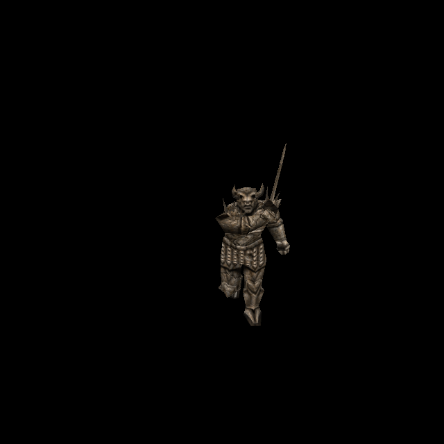

# Rogue Death Knight: compatible artwork reuse and stone skin

Official-game campaign T-bb7e6282, increment T-03622157. Owner authorizes original-
reference ChatGPT generation and separate per-enemy commit/push. Greek Guardian
`d7e466c8` is the published predecessor.

## Exact reuse boundary

Rogue `progs/hknight.mdl` SHA-256:
`ff5e8e7e0339d70fa0edca83a0d082cfc934ae6f60bbbd8f310f32c438646485`.
Two308×154skins,250vertices,452triangles,166poses. Base model identity remains
`78d0273de6850f92d059fa90969f66ee57435330b3c4954c836a7204bc7a9d5a`.

Native skin0 pixels are identical (SHA784bdd23234c131234af86addf1a4111e93525ad2029687c7f524c804f9d18db),
as are UVs, triangles, pose vertex/normal data, meaningful bounds and decoded names.
Ignored frame-padding and bounding-normal bytes differ; whole post-skin byte
identity is not claimed. Independent checks read both actual owned models.

Consequently Rogue skin0 reuses the published `hknight/custom` HD diffuse and
height exactly, with no regeneration or colour changes. Original base manifest
entry, SOURCE and image files remain untouched. `hknight/rogue0` contains byte-
copies and explicit reuse provenance. Unique directories avoid the existing
version/directory material-cache collision between differently constrained model
identities. Parent-relative `../` references would be unsafe for packed lookup,
which does not normalize them; the dedicated test verifies all actual paths resolve
through Newer pack lookup. Git/content-bound normals deduplicate identical bytes.

## Original stone skin

Rogue skin1 is distinct grey/taupe carved stone, not another colour of the supplied
base HD art. ChatGPT imagegen repainted the actual original atlas, preserving both
armoured sides, face/back head, spikes, swords/grips and detached hand pieces.
The1774×887source and exact prompt/recipe are retained as
`tools/texture_sheets/sources/generated-2026-10-12/hknight-rogue-skin1.png` and JSON.

Existing fitter output1848×924covers590558surface pixels;7104(1.20%) use bounded
edge extension, zero are uncovered. No native pigment, UV/pose changes, matte
exception or new emission. Matching anatomical height uses strength0.65/cap0.55.

Catalogue41 appends two explicit Rogue-hash variants: `hknight/rogue0` skin0 and
`hknight/rogue1` skin1. The original base-hash variant remains first and exact.
Four Rogue normal inputs are verified: two existing native inputs, the unchanged
base HD input reused for Rogue0, and one new custom stone input. Only one new
normal payload is added.

Original spawnflag2 selects stone skin1. Activation does not reset it: the enemy
continues moving/fighting as stone. Default statue pose73 is char_a11 unless a map
supplies another frame. This is different from Guardian awakening. QuakeC, damage,
AI and collision remain unchanged.

## Try and verification

Run `python3 tools/serve.py 8000`; open
`http://127.0.0.1:8000/tests/rogue_skin_gpu_trial.html?model=hknight_rogue` and Run.
It renders all332skin/pose combinations, original/custom/detail/Classic controls
and the persistent stone pose. Actual base model bytes are loaded under a temporary
in-memory comparison name, so both native identities can coexist without altering
owned files or confusing positive model loading.

Reproduce stone with `tools/texture_sheets/fit_generated_skin.py` and its recipe
against Rogue pak0. Reused skin0 is a verified copy of the two existing base files.
Bake each new directory using `tools/bake_normals.mjs --namespace rogue --skins
--maps '^progs/hknight\.mdl$' --variant hknight/rogueN`, with configured dependencies.

Independent Rogue10/10 and original base6/6checks pass, including actual native
compatibility, copied bytes, same-name material cache/packed paths, four exact
normal inputs, fallback lifecycle and persistent stone QuakeC. Historical catalogue
checks retain exact original rows/hashes while permitting the two separately tested
Rogue additions; old fixed revision27 and single-variant assumptions were corrected.
The original base image hashes, native UVs and all166poses remain independently pinned.

GPU347/347checks pass over349draws, four shipped normal sets settled, no generated
fallback or shader/runtime errors.30views: angles0–3, poses4–17, stone18–21,
statue73view22, stonepose0view23, controls24–29(native26/fitted27). Source/render
review cleared. Isolated candidate148/148checks and distribution policy pass.
The historical base source JPEG was checked from its Git blob only in the temporary
candidate export; the owner's working-tree deletion remains untouched.

Evidence is retained in `docs/evidence/hknight-rogue-skins-2026-10-12`. Controlled
material/pose behavior is qualified; live combat and owner aesthetic acceptance
remain separate. Concurrent water/cloak work stays excluded.
