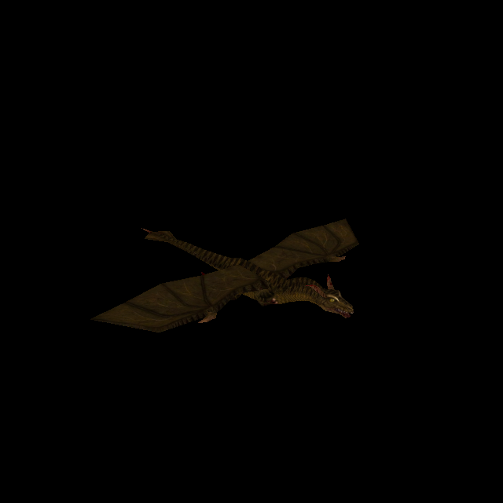
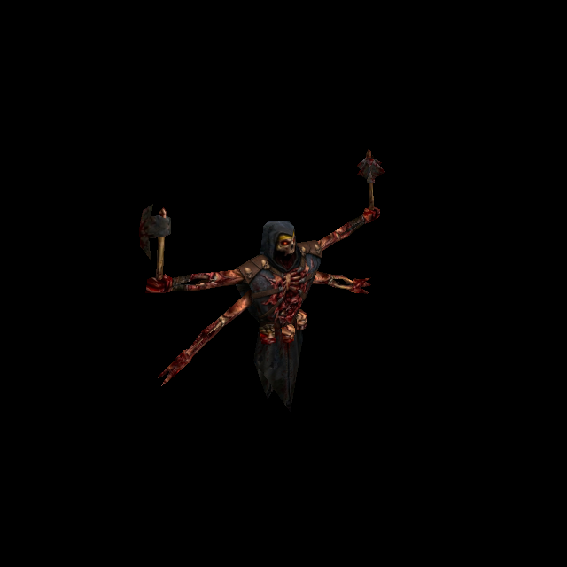
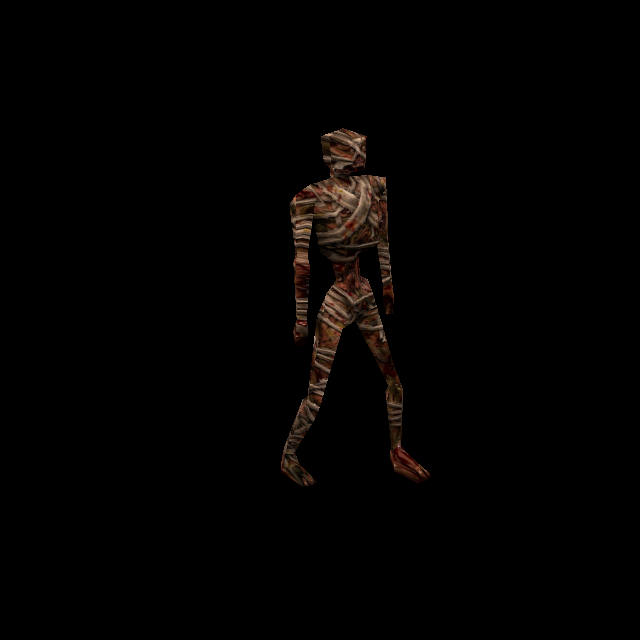

# Dragon, Overlord and Mummy: supplied skin integration

Owner request, 11 October 2026. Existing Bluey cards: T-edc50665 (Dragon),
T-ee16212b (Overlord), T-6d08011e (Mummy). Local working increment in the shared
Dev checkout based on 8c083b91; earlier scorpion work and concurrent water/cloak
changes remain intact. No commit, publication or owner acceptance is claimed.

## Exact model matches

All three models are from the owned **Dissolution of Eternity** (`rogue`) pack.
Each uses one ungrouped skin, index zero. Names alone were not used as identity.
The native atlas, UV/onseam layout and actual model bytes were independently
compared with each supplied sheet before fitting.

| Source identifier | Target | Native atlas | New PNG | Native poses |
| --- | --- | --- | --- | --- |
| `6fxet96fxet96fxe` | Dragon, `progs/dragon.mdl` | 308×179 | [1540×895 first fit; 1232×716 at 4x](../newer/enemies/dragon/custom/diffuse.png) | 101 |
| `ekijfxekijfxekij` | Overlord, `progs/s_wrath.mdl` | 308×186 | [1540×930 first fit; 1232×744 at 4x](../newer/enemies/s_wrath/custom/diffuse.png) | 108 |
| `jc5i6kjc5i6kjc5i` | Mummy, `progs/mummy.mdl` | 168×194 | [1008×1164 first fit; 672×776 at 4x](../newer/enemies/mummy/custom/diffuse.png) | 192 |

The hooded sheet is the four-armed **Overlord**, not ordinary `wrath.mdl`.
The bandaged sheet is **Mummy**, not Zombie. Rogue's Mummy and Zombie have identical
UV/triangle blocks but different native artwork and pose data. Consequently every
new catalogue entry is constrained to the complete model SHA-256 recorded in its
`SOURCE.json`. An identically named model with different bytes cannot select it.
The existing Zombie replacement and ordinary Wrath are unchanged.

## Fitting and source preservation

Each sheet already contains both halves of the native atlas, with matching
proportions and corresponding landmarks. The importer uses a complete-atlas
transform rather than relocating pieces unnecessarily. The supplied resolution
is retained: five times native for Dragon/Overlord, six times for Mummy, whose
source is larger than five times its native skin. Original JPEGs remain unchanged.

`tools/texture_sheets/fit_rogue_skins.py` reuses the existing bounded PAK reader,
`uv_footprint`, `fit_skin.spread` and `height_for`. It validates source/model hashes
and dimensions before writing. Native pixels supply layout only; no native skin
colour is copied. Output pixels come from the supplied image and local edge-colour
extension. The renderer uses the new lossless `diffuse.png` directly.

Background policies are explicit: neutral grey/black divider for Dragon, black
for Overlord, dark brown gradient for Mummy. Narrow dark channels are closed in
the *mask*, retaining enclosed dark artwork rather than repainting ribs or folds.
Actual image colours are preserved during silhouette preparation. Each disconnected
native UV component restricts its own nearby colour donors, with a four-pixel
filter border and a bounded 24-pixel extension. Any uncovered component fails.
Extension affects 1.63% of Dragon, 0.60% of Overlord and 0.27% of Mummy surface pixels.

An initial Mummy mask classified too much dark anatomy as background. Visual
inspection caught the smeared ribs/bandages; the final mask preserves these dark
regions. Final generated assets, hashes, measured coverage and GPU evidence all
refer to the corrected recipe, not that initial output.

Each runtime directory has `diffuse.png`, `height.webp` and `SOURCE.json`, recording
source/model hashes, dimensions, UV coverage, mask policy and output hashes.
Reproduce with Python/Pillow/NumPy/SciPy:

```sh
/usr/bin/python3 tools/texture_sheets/fit_rogue_skins.py
# Optional: --model dragon (or s_wrath/mummy), --pack, --source-root, --output
```

## Integration and normal maps

The existing skin catalogue advances from version 28 to 29 and adds only the three
exact-model skin-zero variants. Their keys join `ENEMY_SKIN_MODELS`; loading,
materials, normal preparation, disposal and Classic fallback use the established
engine path. Native geometry, poses, UVs, collision, AI and PAK files are untouched.

Matching heights are authored from the final diffuse pixels using the established
enemy profile, strength 0.65 and cap 0.55. The existing normal baker adds six payloads:
one native and one replacement per model. Only those six paths are added to the
distribution closure. The stored normal/scalar payloads are bound to their exact
decoded inputs; they are not reused from earlier artwork.

For each key (`dragon`, `s_wrath`, `mummy`), using the existing Three/canvas runtime
environment variables:

```sh
node tools/bake_normals.mjs --pack resources/rogue/pak0.pak --namespace rogue \
  --skins --maps '^progs/dragon\.mdl$' --variant dragon/custom
```

## Try and verify

Run `python3 tools/serve.py 8000`, open
`http://127.0.0.1:8000/tests/rogue_skin_gpu_trial.html?model=dragon`, and press
**Run Rogue enemy checks**. Links select Overlord and Mummy. This finite trial
reads bounded members of the actual owned Rogue PAK through byte ranges and uses
the production model, alias material and post-processing paths. It has no game
loop or saved-state changes. In normal Newer Game, these catalogue replacements
apply when their Rogue models are loaded and **Newer enemies** is enabled.

| Dragon | Overlord | Mummy |
| --- | --- | --- |
|  |  |  |

- Independent public tests: **13/13**, including all 401 native poses, UVs and
  triangles; actual image decoding/hashes; pre-existing catalogue preservation;
  wrong native bytes (including Wrath/Overlord and Zombie/Mummy confusion); skin
  number, Classic, disabled replacements, pending identity and failed-image paths.
- Existing scorpion/skin/startup tests: **19/19**. Catalogue count/model-list
  assertions now include these three additions. The scorpion's historical
  baseline excludes these named later additions, while the new suite separately
  pins every pre-existing entry including the scorpion.
- GPU: **Dragon 112/112**, **Overlord 119/119**, **Mummy 203/203**. All 401 poses
  render with the fitted material, Classic pixels match native controls, height
  changes pixels, and native/custom normal pairs report shipped with zero pending
  or fallback assets. Shader/runtime checks are clean.
- Independent source/asset/rendered review: no blocking findings. Twelve saved
  front/rear/oblique views were inspected; major anatomy and orientation match.
  All six normal payloads were checked against compressed and decompressed hashes.
- Distribution policy: PASS. Logs and per-model GPU receipts are in
  [the evidence directory](evidence/rogue-skins-2026-10-11).

These are exact-model public-interface and controlled renderer checks. Automated
pose coverage is not manual inspection of every pose; dark Dragon renders limit
fine seam inspection. Full campaign traversal/combat, portal views, every lighting
condition, owner appearance acceptance, landing and release remain separate.
The owner can inspect the PNGs and finite previews now; the existing cards remain
open for acceptance/qualified delivery. No unattended follow-up job is claimed.

Under the [4x standard](texture-standard-4x-2026-10-12.md), the dragon, Overlord and
mummy are re-fitted at factor 4 through the built-in recipes in `fit_rogue_skins.py`:
1232×716, 1232×744 and 672×776. Sizes and pixel counts above describe the first fit.
