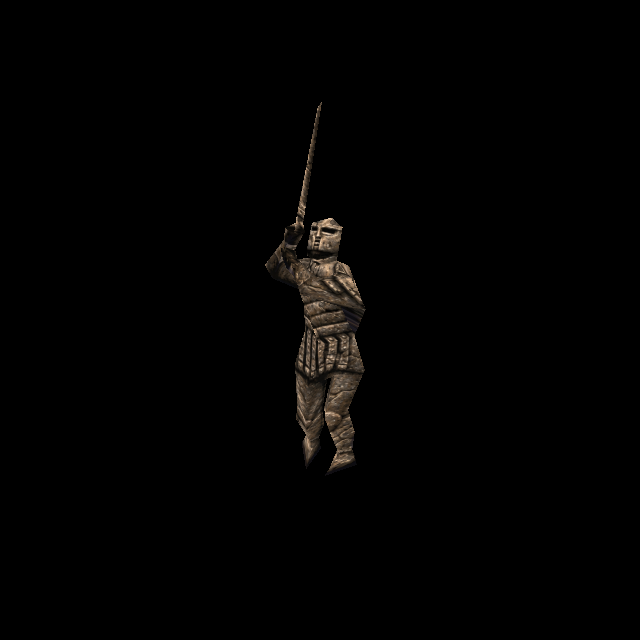

# Rogue Knight statue: stone skin and correct native relief

Official-game campaign T-bb7e6282, increment T-73be2ab4. Owner authorizes original-reference
ChatGPT generation and separate per-enemy commit/push. Rogue Spawn `bcc84b6f` is the
published predecessor.

Rogue `progs/knight.mdl` SHA-256:
`749325dd12abbfae8fc89416f217fa07c6d06bd30fed7359e599a04d969eefcf`.
Two 268×194 skins, 108 vertices, 213 triangles and 97 ungrouped poses. Base identity
is `094c278cba9851a940e3e40e4f209f372b916ad7bac68ba13efd7c0d7d676ed1`.
Geometry, UVs and ordinary skin0 pixels match base; four frame names at72–75 differ
and are explicitly preserved. Whole meaningful-record identity is not claimed.

The existing legacy slot0 variant already serves compatible Rogue0. Its images,
face metadata and native-height group0 remain exact; no copied or tightened legacy
variant is needed. Catalogue43 appends only `knight/rogue1`, explicit skin1 and exact
Rogue model hash, without living-face overlays. Actual QuakeC flag2 selects stone;
default statue frame44 may be overridden by the map, and activation retains stone.
AI, geometry and gameplay are unchanged.

## Generation and corrected fitting

ChatGPT imagegen repainted original stone skin1, preserving ordinary Knight armour,
helmet, swords, front/back differences and muted grey/taupe stone. It does not add
Death Knight spikes or a living face. The1475×1067 source, exact prompt and recipe
are retained in `tools/texture_sheets/sources/generated-2026-10-12/knight-rogue-skin1.*`.
Dominant source backdrop is RGB27/27/47. First-pixel palette index1 is grey15 and is
not the dominant backdrop; this distinction matters for matte extraction.

Initial automated checks passed, but independent visual review detected blue-grey
bands beneath arms and at feet:1889 backdrop-like pixels inside the reviewer’s UV
mask,1781 corresponding to nonblue native art. Silhouette closing/filling had
admitted some background as colour donors. The initial fit, GPU receipt, normal
log and a representative screenshot remain retained.

An opt-in `strictMatteDonors` policy now filters actual resampled donor colour for
this neutral stone recipe, even when silhouette processing included it. It rejects
1227 donor seeds; the1889 count includes their propagated output and is different.
The existing24pixel reach and uncovered-surface rejection remain unchanged. Earlier
recipes have no new flag and retain their behavior. Final1608×1164 output covers
406290 surface pixels,11810 through bounded edge extension, zero missing. An
independent pixel-centre raster of native triangles finds zero backdrop pixels
across402808 samples. Source image and legacy assets are unchanged.

## Native height and normal integration

Previously native skin1 inherited stored skin0 height via `groups[skin] || groups[0]`.
Explicit `nativeHeights.knight[1] = []` suppresses that fallback: an empty array is
truthy, has no authored candidate, and derives relief from actual native stone
pixels. Group0 remains exact. Runtime and baker already share this contract;
no engine API change is introduced.

The corrected native family references native0 generated fallback, native0 stored
height and native1 generated height. It no longer references the inappropriate
native1-plus-living-height combination. Existing historical payloads are retained;
one new custom stone payload is added. Legacy custom0 normals remain unchanged.
Provisional custom bake data is archived outside runtime and excluded from final
manifest/registry. Standard strength0.65/cap0.55 and no new emission apply.

## Try and verification

Run `python3 tools/serve.py 8000`; open
`http://127.0.0.1:8000/tests/rogue_skin_gpu_trial.html?model=knight_rogue` and Run.
Both skins render through all97poses, with native/custom/detail/Classic controls,
statue frame44 and actual base-model identity comparison.

Reproduce with `tools/texture_sheets/fit_generated_skin.py` and the statue recipe
against Rogue pak0. Bake with `tools/bake_normals.mjs --namespace rogue --skins
--maps '^progs/knight\.mdl$' --variant knight/rogue1`, using configured dependencies.

Corrected independent suite11/11 passes, including decoded UV colour, all native
geometry and four known name differences, legacy face uniforms vs none on stone,
identity/failure paths, no living-height fetch for native stone and exact normals.
Fresh-origin GPU209/209 checks pass over211draws/194skin-pose combinations; four
active normal sets are shipped/settled, with no shader/runtime error. Views0–3show
living angles,4–13poses,14–17stone controls,18statue44,19stonepose0,20–25final controls.

Isolated committed-HEAD plus scoped source passes177/177 checks; distribution passes.
Final source/render review cleared. Initial passing tests and their visual blind
spot are retained honestly in `docs/evidence/knight-rogue-skin-2026-10-12`.
This qualifies controlled material/pose behavior; live gameplay and owner aesthetic
acceptance remain separate. Concurrent water/cloak work and owner deletions remain
outside the commit.

Under the [4x standard](texture-standard-4x-2026-10-12.md), the statue skin is re-fitted
at factor 4 through its recipe: 1072×776. Sizes and pixel counts above describe the
first fit.
