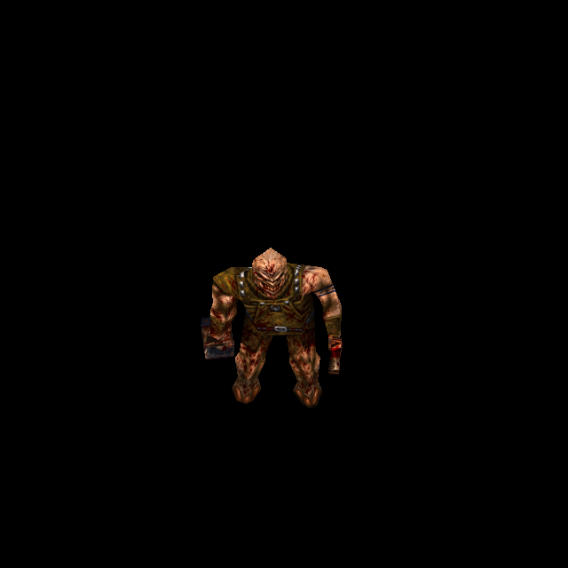

# Rogue multi-grenade Ogre: alternate skin and correct relief

Campaign T-bb7e6282, final increment T-328a3c5a. The owner authorized generation
from original files and a separate commit/push for each completed enemy. The
published predecessor is Rogue Knight statue `598d28ff`.

Rogue `progs/ogre.mdl` has SHA-256
`2bd7b6633d2c95627cca8b216ad2c84057e800778a94e0fa97f3a14f86420732`:
two 264×194 skins, 169 vertices, 326 triangles and 147 poses. Slot 0's pixels,
UVs, triangles and meaningful pose records match the original Quake Ogre. Its
existing custom art, face metadata and authored native height remain unchanged.

The alternate skin uses green/olive studded clothing. ChatGPT imagegen received
the decoded original skin 1 and retained its six UV parts, flesh, chainsaw and
launcher. The exact prompt and 1462×1076 generated source are preserved at
`tools/texture_sheets/sources/generated-2026-10-12/ogre-rogue-skin1.*`.
The source SHA-256 is
`a9f0e23b55392bfcef3045861a0f9f9ce49955de2b5017a8c6e857fad3c0f4e0`.
The existing fitter produces a 1584×1164 atlas with 947,897 covered surface
pixels, 41,585 supplied by bounded edge extension, and zero uncovered pixels.
The recipe uses the original dark-brown matte, without modifying shared fitting
rules. `newer/enemies/ogre/rogue1/SOURCE.json` retains the fitting measurements.

Catalogue 44 appends `ogre/rogue1` with explicit skin 1 and the exact Rogue MDL
hash, without ordinary face overlays. Native height group 1 is an empty array:
the existing truthy-group contract prevents fallback to ordinary skin 0 height
and derives relief from the alternate native pixels. No engine API changes are
needed. One custom normal payload is added, and the Rogue native family now
references the correct generated/stored inputs. Historical payloads are retained.
The normal strength is 0.65, cap 0.55, with no new emission.

QuakeC's flag 2 selects the persistent multi-grenade variant. The native random
selection and multi-grenade projectile/death-ammunition behavior are unchanged.
The first independent run passed 10/11 checks because its small QC evaluator
lacked `OP_BITOR` (65), which that selection uses. Adding the real opcode to the
test evaluator resolved the failure; no product code was changed to pass it.

## Verification and trying the result

Run `python3 tools/serve.py 8000` and open
`http://127.0.0.1:8000/tests/rogue_skin_gpu_trial.html?model=ogre_rogue`, then Run.
The trial renders both skins through all 147 poses and includes original/custom,
normal-detail and Classic controls plus an actual base-model identity comparison.

The independent suite passes 11/11 checks. The real GPU trial passes 307/307
checks over 309 draws and 294 skin/pose pairs, with four active shipped normal
sets and no runtime/shader error. Independent source/render review found no
blocking defect in the armour, face, weapons or matte edges. Saved views 0–14
cover ordinary skin angles/poses; 15–18 cover the alternate skin and comparisons;
19–24 contain the final material controls.

The final campaign audit verifies all 50 official-game body-skin slots. Detailed
receipts, source hashes, normal bake output and isolated candidate checks are in
`docs/evidence/ogre-rogue-skin-2026-10-12`; the inventory report is in
`docs/evidence/official-body-skin-audit-2026-10-12`. These establish controlled
asset and public-render-interface behavior, not live combat or owner aesthetic
acceptance. Unrelated water/cloak work and owner deletions are excluded.

The isolated candidate passes 188/188 regression checks (38 base-game, 122 Rogue,
28 Hipnotic), plus 36/36 final coverage checks: 224/224 total. Distribution policy
also passes. The first isolated base-game run retained a stale test expectation:
its computed roster counted the new identity-bound Ogre art before any model was
loaded. Actual early prefetch correctly deferred it. The corrected test retains
the original 20-request bound and explicitly verifies deferral, base-model
rejection and later Rogue eligibility. Both the initial 37/38 log and corrected
38/38 log are retained; no engine behavior changed for this correction.
