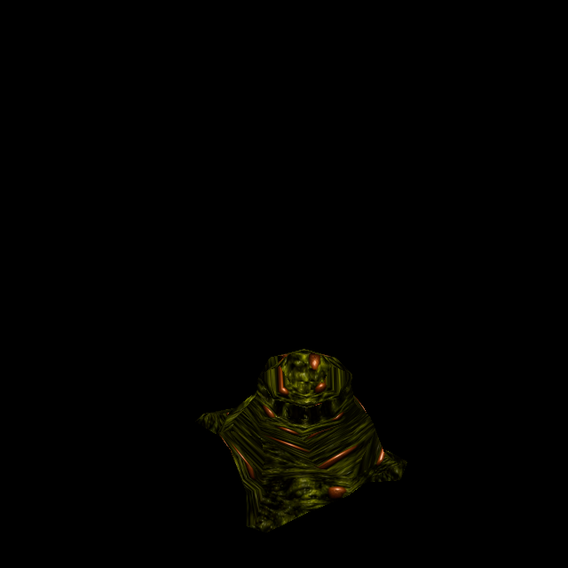

# Rogue Spawn: compatible HD reuse and green variants

Official-game campaign T-bb7e6282, increment T-e2dbdfec. Owner authorizes original-reference
ChatGPT generation and a separate commit/push for each completed enemy. Rogue Death
Knight `4a0375d7` is the published predecessor.

## Native identity and reuse

Rogue `progs/tarbaby.mdl` SHA-256:
`5dd6250329f64a9570021ced7a40d9c46020f46ad046366100cf0a7c6bd8612e`.
It has three ungrouped 304×194 skins, 130 vertices, 256 triangles and 61 poses.
The two body UV components retain their original shapes. Base identity is
`9933ee9b251e4c32a22129e2a9cda8cebfd2f317aeb2961a0591a098e9e823ea`.

Native skin0 pixels, UVs, triangles, meaningful frame bounds/names/vertex-normal
records and header fields except skin count match base. Existing `tarbaby/custom`
HD diffuse and height therefore copy byte-exactly into unique `tarbaby/rogue0`
with explicit reuse provenance and the Rogue hash. The original base entry, images
and SOURCE remain untouched. Unique directories preserve material-cache and packed
asset lookup contracts, as verified for the preceding Death Knight increment.

## Original green variants

Skin1 is dark olive-green with the original ridges and crevices. Skin2 retains that
body and adds modest brown/orange nodules. They are persistent enemy variants, not
animation stages. Actual QuakeC flag8 selects skin2, flag4 selects skin1, flag2
selects skin0; the default path uses original skill/random selection. Mitosis
copies the parent's skin to offspring. Death uses frame60 and the existing explosion
path; no new attachment, geometry or emission behavior is introduced.

ChatGPT imagegen repainted original skin1, then edited that fitted layout using
original skin2 for nodule placement and colour. Selected sources are
`tools/texture_sheets/sources/generated-2026-10-12/tarbaby-rogue-skin1.png`
(1570×1001) and `tarbaby-rogue-skin2.png` (1570×1002); recipes retain exact prompts,
source hashes and reference relationships. Both outputs are 1824×1164 and have
full direct coverage of 622,551 surface pixels, with zero edge extension or missing
coverage. Original off-surface spare nodule dots do not become new body geometry.

Each new variant has its own anatomical height so nodules may contribute relief.
No new luma or flat-height exception is added. Existing blue-background handling,
UVs, geometry, behaviour and Classic remain intact. Catalogue42 appends three
explicit Rogue skin bindings in `tarbaby/rogue0`, `rogue1`, `rogue2`.
Six Rogue normal references are verified: three native inputs and the base HD input
already existed; only two new custom payloads are needed.

## Try and reproduce

Run `python3 tools/serve.py 8000`; open
`http://127.0.0.1:8000/tests/rogue_skin_gpu_trial.html?model=tarbaby_rogue` and Run.
All 183 skin/pose combinations render, including jumps and frame60, with native,
replacement, detail and Classic controls. Actual base model bytes are an isolated
in-memory negative comparison without changing owned files.

Reproduce each new recipe through `tools/texture_sheets/fit_generated_skin.py`
against Rogue pak0. Skin0 is a verified copy of the published base files. Bake with
`tools/bake_normals.mjs --namespace rogue --skins --maps '^progs/tarbaby\.mdl$'
--variant tarbaby/rogueN`, using established Three/canvas dependencies.

## Verification and limits

Independent new tests 12/12 and original base regressions 6/6 pass: actual source
compatibility, all native records, four simultaneous base/Rogue bindings and packed
paths, exact normal inputs, source/output preservation, spawnflag/random behavior
and offspring skin inheritance. Historical catalogue checks preserve exact original
rows while permitting separately tested append-only variants.

GPU 198/198 checks pass over 203 draws, with six normal sets shipped and settled,
no generated fallback or shader/runtime error. Views 0–3 show ordinary-skin angles,
4–10 its poses, 11–14 green (native13/fitted14), 15–18 nodules (native17/fitted18),
and 19–24 controls (native21/fitted22). Review confirms the pronounced surface
stretching is inherited from the native UVs; no geometry change is concealed.

Isolated committed-HEAD plus scoped changes passes 166/166 checks; distribution
policy passes. Historical supplied JPEGs are checked only from Git blobs in the
temporary candidate export; owner working-tree deletions remain untouched. All
receipts and review are retained under `docs/evidence/tarbaby-rogue-skins-2026-10-12`.
Controlled material/pose behavior is qualified; live gameplay and owner aesthetic
acceptance remain separate. Concurrent water/cloak work is excluded.
