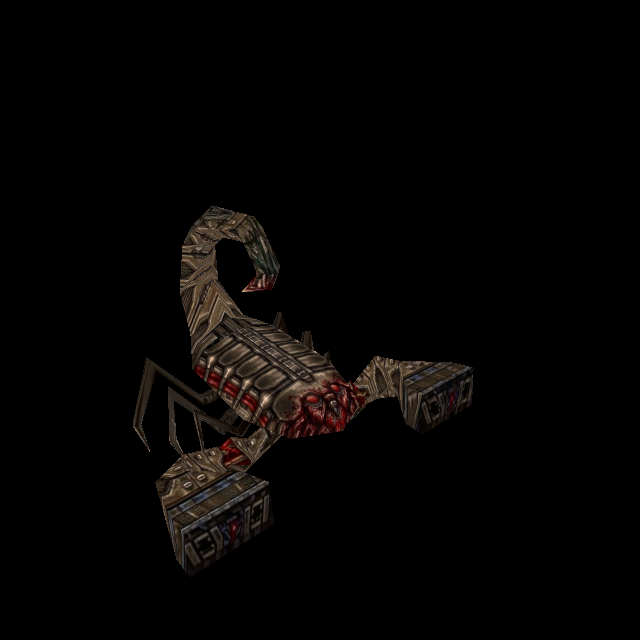

# Centroid: combined front and back skin

Owner request, 11 October 2026; tracked under Bluey T-7a985e2c. This is a local
working increment in the shared Dev checkout, based on 8c083b91. It has not been
committed, published or accepted by the owner. Concurrent water and invisibility
work is outside this change.

## Result and how to try

[Combined 1540 × 780 PNG](../newer/enemies/scor/custom/diffuse.png) is the actual
runtime skin, with both halves fitted to the original Centroid from Scourge of
Armagon (`progs/scor.mdl`, native 308 × 156). The original MDL has one skin,
235 vertices, 422 triangles and 41 animation poses. It is distinct from Arcane
Dimensions' `mon_scorpion.mdl`; the replacement cannot match that model.

Run `python3 tools/serve.py 8000`, then open
`http://127.0.0.1:8000/tests/scorpion_skin_gpu_trial.html` and press **Run Centroid
checks**. This finite trial uses the actual owned Hipnotic model and production
alias/material renderer, showing front, back, oblique and all animation poses.
It requires `resources/hipnotic/pak0.pak` and the bundled shareware palette. The
server must support ranges; the supplied server does. There is no game loop or
save-state mutation. In normal Newer gameplay with Scourge of Armagon selected,
the same catalogue entry replaces Centroids when **Newer enemies** is enabled.



## Extraction and fitting contract

- `aa0f86eb-168c-4ed4-b4c4-df318d5b0ed6.jpeg` supplies the left/front atlas half.
- `4d36fc39-968f-460d-934d-6690cc5f663c.jpeg` supplies the right/back half.
- Both source files remain unchanged. The upper-left body pieces are extracted
  directly, without generating new artwork. The rendered scenes on the right
  and lower-left detached-head atlases are excluded. `h_scourg.mdl` stays native.
- Five pieces per half are fitted separately: two long limbs, torso, tail and
  thin limb. Placement uses the existing detail-registration helper against the
  original texture, constrained by the actual model's UV footprint. The back
  torso and tail have intentionally different internal artwork, so their low
  correlation is not treated as alignment evidence: measured silhouette bounds
  are used. Explicit source masks prevent neighbouring islands entering these
  crops. Edge colour extension supplies filtering margins.
- Two small red joint islands are absent from the supplied sheets. They retain
  original pixels: 4,262 of 791,408 surface pixels, approximately 0.54%. These are
  persistent model geometry, not a presumed muzzle flash. Their filter borders
  are also retained and counted separately in the provenance record.
- No model vertices, native UVs, pose data, collisions, AI or original PAK bytes
  change. The new PNG is opaque RGB, sampled with the existing skin convention.

`tools/texture_sheets/fit_scorpion.py` reuses `fit_enforcer.register`,
`fit_skin.spread`, `uv_footprint`, `height_for` and bounded PAK-member reads.
`newer/enemies/scor/custom/SOURCE.json` pins both source hashes, the native model
hash, every crop/placement, retained native area and output hashes. Reproduce:

```sh
/usr/bin/python3 tools/texture_sheets/fit_scorpion.py
```

It requires Pillow, NumPy and SciPy. Alternative packs/source/output directories
are explicit command-line arguments; mismatched source/model hashes are rejected.

## Engine wiring and failure handling

The existing `newer/enemies/index.json` gains one `scor/custom` skin-zero variant
and advances version 27 to 28. It is restricted to native MDL SHA-256
`13f3baa6760b38c1a7ba30eea9b581754dd87eeb1875248ce6feb1d1efb3582f`.
The existing `ENEMY_SKIN_MODELS` set gains `scor`, allowing the shared relief path.
There is no new renderer or alternate selection API. Wrong model bytes, other
skin numbers, pending identity, failed downloads, Classic mode and disabled
Newer enemies retain the established original-skin fallback.

`height.webp` is authored from the final fitted PNG with the existing restrained
enemy-height recipe (strength 0.65, cap 0.55). The existing normal baker creates
one native and one replacement normal payload, registered under
`hipnotic:progs/scor.mdl` and `custom:scor/custom`. The distribution closure adds
only those two payload paths. Example bake command, with existing Three/canvas
module paths supplied in the environment:

```sh
node tools/bake_normals.mjs --pack resources/hipnotic/pak0.pak \
  --namespace hipnotic --skins --maps '^progs/scor\.mdl$' --variant scor/custom
```

## Verification and limits

An independent planner identified the native model, source halves, disconnected
UV islands and separate detached head before implementation. An independent
tester wrote and ran five public-contract cases: actual native bytes and all
poses/UVs/triangles, actual decoded assets and source/output hashes, catalogue
isolation, exact-model selection, and Classic/pending/failure/shutdown behavior.
All five passed. The coordinator also ran the neighbouring skin/startup suites;
19/19 now pass. The retained logs distinguish the catalogue-count/model-list fixture updates and a
temporary concurrent `R_CloakReset` import failure from actual test passes.

The saved [GPU receipt](evidence/scorpion-skin-2026-10-11/gpu.json) records 52/52
checks, 51 draws, all 41 poses, four angles, exact Classic comparison, visible
replacement and height differences, two shipped normal maps, zero pending/fallback
assets and no shader/runtime errors. Four rendered standing views are retained.
Independent code/asset review found no blockers and verified both source hashes,
PNG/height hashes, and compressed/decompressed normal-bake hashes. Independent
visual review of those four views found no obvious reversed islands, unrelated
image fragments or uncovered patches. It did not independently inspect all
sting/death undersides. Normal traversal/combat, all-level lighting and owner
appearance acceptance are not claimed by this controlled model trial.

The initial browser download stalled despite its requested timeout. No runtime
failure is inferred from that tool failure. Evidence was subsequently saved via
a temporary loopback-only receiver with fixed output names; that receiver is
not part of the product. The trial's optional `saveEvidence` query is solely for
that local receiver; ordinary runs provide the download link.

No source files or concurrent work were deleted. Bluey refused the attempted
Backlog-to-Next selection despite the direct chat request; progress remains on
the existing card without claiming a successful status/assignment transition.
The next owner action is to inspect and accept or revise this local skin. The
broader root-skin card and detached-head replacement are not declared complete.
