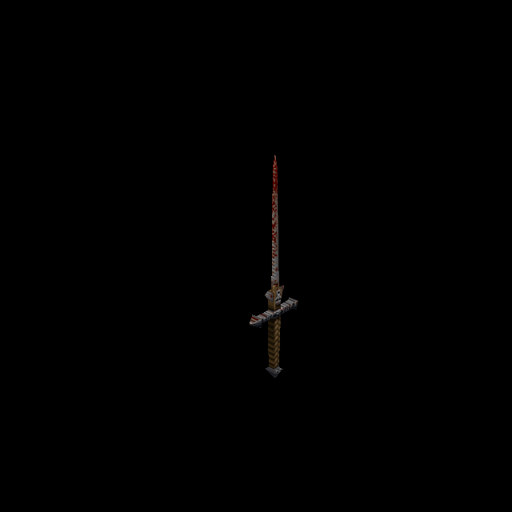

# Phantom Swordsman: original-design sword skin

Official-game campaign T-bb7e6282, increment T-98629a4a. Owner authorizes original-
reference ChatGPT generation and separate per-enemy commit/push. Predecessor
Electric Eel `ba2b8779` is published and remote verified.

## Native correspondence

Rogue monster_sword uses only `progs/sword.mdl`, SHA-256
`a72818767602e676cb08aa19db1780df9ee71b1f5c650f24c4f7ad2f761360d2`:
one124×195skin,58vertices,106triangles,40ungroupedposes. Front and back atlas halves
differ in759native pixels; neither is replaced by a copy of the other. There is
no visible wielder, attached body or alternate skin. Existing DIMLIGHT behavior
and its death reset remain unchanged; no luma/emission map is added.

ChatGPT imagegen repainted the complete decoded native atlas, preserving its
narrow grey bloodstained blade, angular crossguard, brown/olive wrapped grip,
pointed pommel and distinct markings on both sides. The1000×1573source, exact
prompt and model/source hashes are retained in
`tools/texture_sheets/sources/generated-2026-10-12/sword.png` and `sword.json`.

The existing fitter outputs992×1560. Native UVs and geometry are unchanged;
26of217280surface pixels need bounded edge extension, with zero missing coverage
and zero native low-resolution pigment copied. Source aspect differs by−0.0267%;
measured UV detail correlation0.698 supports the visual correspondence.

## Runtime and reproduction

Catalogue35 adds `sword/custom` with explicit skin0 and exact native-model hash.
`sword` joins the existing enemy classification. Matching anatomical height uses
the established strength0.65/cap0.55 profile. Two exact input-bound normal payloads
cover generated native relief and the custom diffuse/height pair. Wrong model,
pending identity, disabled replacement, failed downloads and Classic retain their
established fallback paths. No gameplay, collision or model animation changes.

Run `python3 tools/serve.py 8000`, open
`http://127.0.0.1:8000/tests/rogue_skin_gpu_trial.html?model=sword` and press Run.
The finite production-renderer trial covers all40poses: stand0, run1–8,
attack9–18, death19–28 and29–39. It includes native/custom/detail/Classic controls.

Fit with `/usr/bin/python3 tools/texture_sheets/fit_generated_skin.py
 tools/texture_sheets/sources/generated-2026-10-12/sword.json
 --pack resources/rogue/pak0.pak`. Bake with the existing `tools/bake_normals.mjs`,
`--namespace rogue --skins --maps '^progs/sword\.mdl$' --variant sword/custom`,
using configured Three/canvas dependencies.

## Verification

Independent public checks6/6pass first run: all native UV/triangle/pose data,
distinct sides, source/output identity, prior catalogue, material/failure
boundaries and both decoded normal inputs. GPU51/51checks pass across50draws;
both normal sets are shipped and settled with no generated fallback or shader/
runtime errors. Savedviews0–3show angles;4–13show selected pose boundaries;
14–19show controls (native16/fitted17).

Isolated committed-HEAD plus scoped changes:88/88checks pass, excluding concurrent
water/cloak work. Distribution policy passes. Independent rendered/source review
is retained in `docs/evidence/sword-skin-2026-10-12/review.md`. This qualifies the
controlled asset/material behavior; live combat and owner appearance acceptance
remain separate. All sources, receipts and selected screenshots are retained.
