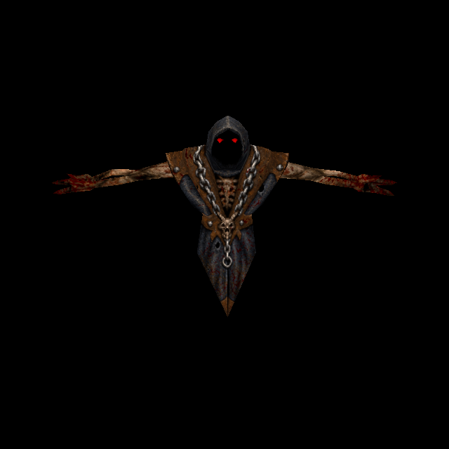

# Ordinary Wrath: body and persistent red eyes

Official-game campaign T-bb7e6282, increment T-d0114751. Owner authorizes original-
reference ChatGPT generation, original design preservation and separate per-enemy
commit/push. Predecessor Phantom Swordsman `d8c0b53e` is published.

## Native correspondence and anatomy

Rogue `progs/wrath.mdl`, SHA-256
`0a57ee912df3142c5e17183d5f6bd461021b141d53f7534014d59eda97e6bfa6`, has one248×194skin,
212vertices,420triangles and87ungroupedposes. It is distinct from Overlord
`s_wrath.mdl`, which already has its own replacement. Actual model bytes are the
selection boundary; matching a filename cannot grant this skin to another model.

Two body UV components accompany four red patches. Vertices7–16 form persistent
solid eye geometry within the hood, across every pose. The hood itself remains
faceless and black. These are not Armagon-style non-solid flashes: use ordinary
anatomical height, no255height bypass and no new luma. A6pixel native eye plateau
would overlap240 genuine robe/body UV pixels. Native attack MUZZLEFLASH and separate
w_ball projectiles, death gibs, AI and physics remain unchanged.

## Source, failed fit and measured correction

ChatGPT imagegen repainted the complete original palette-decoded atlas. Its
1418×1109source and exact prompt/recipe are retained in
`tools/texture_sheets/sources/generated-2026-10-12/wrath.png` and `wrath.json`.
Charcoal cloth, brown leather, chains/rings, wounded arms and all four eye patches
remain distinct. No model UVs are edited.

The first full-atlas fit correctly rejected component1. A root diagnostic initially
reported504missing pixels using cross-shaped dilation, but the real fitter uses
all eight neighbours. Independent exact reproduction found19uncovered pixels
(3first body/16second body), all native palette0 and generated RGBmaximum<=1.
They are intended black upper-arm gaps. Native skin flood-fill returns unchanged
when its initial index is0; this black is real runtime pigment, not transparency.

Two explicit native-pixel boxes `[7,85,10,88]` and `[131,85,134,88]` admit generated
black only where actual UV coverage, original palette0 and generated RGB<=1 all
agree.458source pixels qualify;19were previously uncovered,439would otherwise
receive spread colour. This preserves intended generated black without copying
native pigment, moving anatomy or increasing the24pixel bleed limit. Every other
uncovered pixel is still rejected. SOURCE records the exact bounds/count/rules.

Separately, measured vertical registration `[0,0,1488,1180]`, cropped to1488×1164,
improves native-detail correlation0.123→0.510. Hood, chains/chest, arms, robe and
both eyes all improve individually; recipe records the measurements. This1.37%
scale correction addresses landmark placement, not the black-mask semantics.
Before the black allowance it leaves46black misses; the same bounded allowance
plus existing edge reach resolves all. Final coverage724578pixels,8295edge
extensions (1.145%), zero missing. Original/generated source files stay unchanged.

The root prematurely started baking before inspecting the initial fit's failed
exit; that bake failed on absent diffuse. Both failures and the diagnostic
correction are retained. Final bake ran only after successful fitting.

## Runtime, reproduction and evidence

Catalogue36 registers `wrath/custom`, explicit skin0 and exact model identity.
The existing enemy material path supplies matching anatomical height and two
prepared normal payloads: generated native and fitted custom. Standard strength
0.65/cap0.55, Classic/failure/disabled/pending/wrong-model behavior remain intact.

Run `python3 tools/serve.py 8000`; open
`http://127.0.0.1:8000/tests/rogue_skin_gpu_trial.html?model=wrath` and press Run.
The finite production-renderer trial covers all87poses: reference0, walk1–12,
attacks13–54, pain55–71, death72–86, plus native/custom/detail/Classic controls.

Reproduce with `/usr/bin/python3 tools/texture_sheets/fit_generated_skin.py
 tools/texture_sheets/sources/generated-2026-10-12/wrath.json
 --pack resources/rogue/pak0.pak`. Existing baker options: `--namespace rogue
--skins --maps '^progs/wrath\.mdl$' --variant wrath/custom`, with configured
Three/canvas dependencies.

Independent tests7/7pass first execution: native bytes/UVs/all poses, persistent
eye geometry, black hood, red eyes without255plateau, bounded black provenance,
actual Overlord spoof rejection, fallbacks, prior catalogue and exact normals.
GPU98/98checks pass across97draws; both normal sets shipped/settled, no generated
fallback or shader/runtime errors.24views retained: angles0–3, sampledposes4–17,
controls18–23 (native20/fitted21). Independent source/render review cleared.

Isolated committed-HEAD plus scoped source passes95/95checks; distribution policy
passes. Concurrent water/cloak edits are excluded. Evidence is retained under
`docs/evidence/wrath-skin-2026-10-12`. Controlled asset rendering is qualified;
live combat and owner appearance acceptance remain separate.
